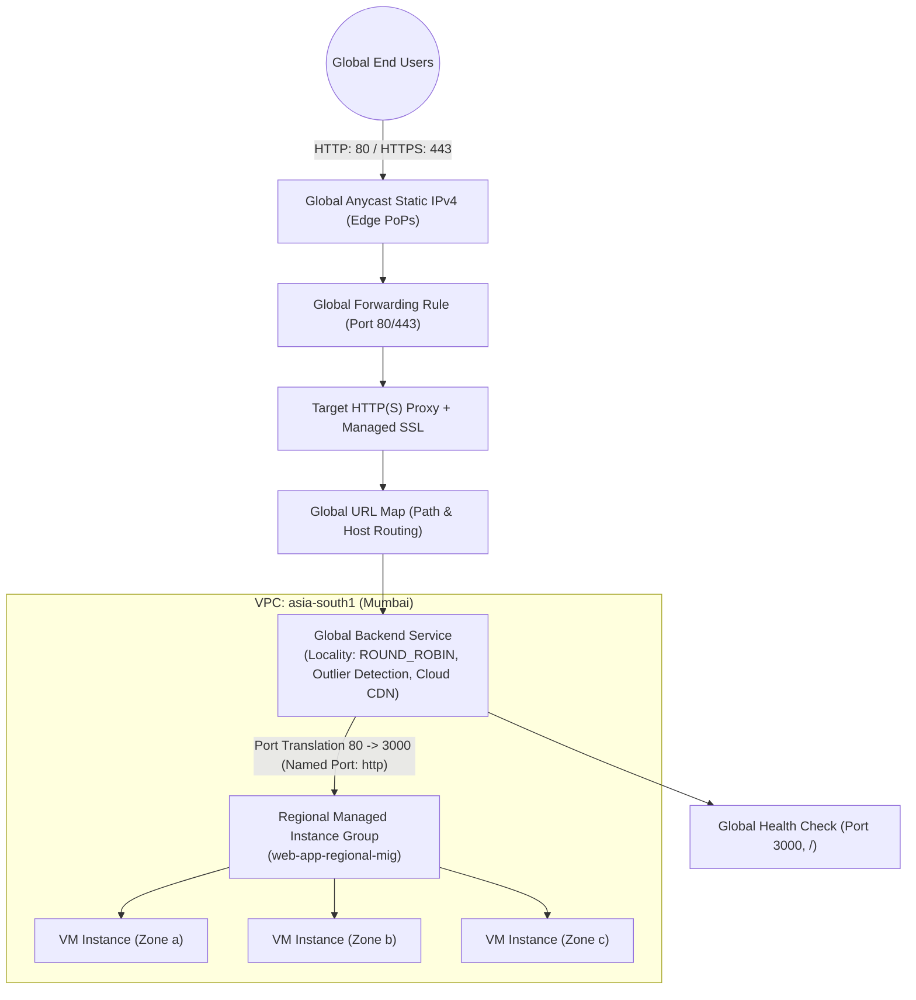

# GCP Terraform Custom Module: Availability Infrastructure

A production-ready, 100% YAML-driven Google Cloud Platform (GCP) Terraform custom module for provisioning enterprise global and regional traffic management, load balancing, caching, and autohealing health checks.

Designed with the exact sequential numbered structure as `compute-infrastructure` for maximum performance, resilience, and declarative plug-and-play simplicity.

---

## Architecture Overview

```
availability-infrastructure/
├── 0-locals.tf              # 100% YAML parsing, normalization, MIG group resolution & defaults
├── 1-health-checks.tf       # Global & regional health checks (HTTP/HTTPS/TCP/SSL/gRPC)
├── 2-external-http-lb.tf    # Global External L7 HTTP(S) LB + Managed SSL + URL Maps + Outlier Detection
├── 3-internal-http-lb.tf    # Regional Internal L7 HTTP(S) LB for private microservices (Envoy)
├── 4-internal-tcp-lb.tf     # Regional Internal L4 Passthrough Network LB (Active-Passive Failover)
├── 5-cloud-cdn.tf           # Cloud CDN signed URL keys & cache management
├── outputs.tf               # Public/private IPs, forwarding rules, URL maps & summary status
├── variables.tf             # Declarative inputs (config_file_path, yaml_content, mig_backend_groups)
└── versions.tf              # Provider and Terraform version constraints
```



---

## Plug-and-Play YAML Architecture

Each load balancer tier is completely independent and plug-and-play. You can plug in the **External HTTP(S) LB**, comment it out and plug in the **Internal HTTP LB**, or plug in the **Internal TCP LB** (with active-passive failover) without changing Terraform code!

### Plug-and-Play Example (`availability-infrastructure.yaml`)

```yaml
availability:
  project_id: "yuvaraj-internal-project"
  region: "asia-south1"

  tags:
    environment: "testing"
    managed_by: "terraform"

  # ============================================================================
  # 1. External L7 HTTP(S) Load Balancer (Plug & Play - Attach to MIG)
  # ============================================================================
  external_http_lb:
    name: "glb-web-app"
    load_balancing_scheme: "EXTERNAL_MANAGED"
    port: 80
    target_mig: "web-app-regional-mig" # Attach directly to your compute MIG
    named_port: "http"                 # Resolves port 3000 on instances

    # Plug & Play Cloud CDN Option:
    enable_cdn: true
    cdn_policy:
      cache_mode: "CACHE_ALL_STATIC"
      default_ttl: 3600
      max_ttl: 86400
      client_ttl: 3600
      negative_caching: true

    # Auto-Generated Global Health Check:
    health_check:
      type: "HTTP"
      port: 3000
      request_path: "/"
      check_interval_sec: 10
      timeout_sec: 5
      healthy_threshold: 2
      unhealthy_threshold: 3
      logging: true

    # Resilience: Outlier Detection (Passive Health Checks / Circuit Breaker)
    outlier_detection:
      consecutive_errors: 5
      base_ejection_time:
        seconds: 30

  # ============================================================================
  # 2. Regional Internal L7 HTTP LB (Plug & Play - Simply uncomment to enable)
  # ============================================================================
  # internal_http_lb:
  #   name: "ilb-web-app"
  #   network: "projects/yuvaraj-internal-project/global/networks/testing-environment-vpc"
  #   subnetwork: "projects/yuvaraj-internal-project/regions/asia-south1/subnetworks/testing-environment-private-subnet-mumbai"
  #   port: 80
  #   target_mig: "web-app-regional-mig"
  #   named_port: "http"
  #   health_check:
  #     port: 3000
  #     request_path: "/"

  # ============================================================================
  # 3. Regional Internal L4 TCP Passthrough LB (Active-Passive Failover)
  # ============================================================================
  # internal_tcp_lb:
  #   name: "nlb-web-app"
  #   network: "projects/yuvaraj-internal-project/global/networks/testing-environment-vpc"
  #   subnetwork: "projects/yuvaraj-internal-project/regions/asia-south1/subnetworks/testing-environment-private-subnet-mumbai"
  #   ports: ["3000"]
  #   target_mig: "web-app-regional-mig"      # Active Primary MIG
  #   failover_mig: "web-app-failover-mig"    # Passive Failover MIG
  #   failover_policy:
  #     failover_ratio: 0.1
  #     disable_connection_drain_on_failover: false
  #     drop_traffic_if_unhealthy: true
  #   health_check:
  #     type: "TCP"
  #     port: 3000
```

---

## Terraform Integration

Invoke the module cleanly by linking `mig_backend_groups` directly to `module.compute.managed_instance_groups`:

```hcl
module "availability" {
  source = "../../gcp-terraform-custom-modules/availability-infrastructure"

  config_file_path = "${path.module}/availability-infrastructure.yaml"

  # Seamlessly passes instance groups created by compute module to the LB backend:
  mig_backend_groups = {
    for k, v in module.compute.managed_instance_groups : k => v.instance_group
  }
}
```

---

## Key Resilience Features

1. **Passive Health Checking & Circuit Breaking (`outlier_detection` & `circuit_breakers`)**:
   Automatically detects and ejects failing backend VM instances before active health probes fail.
2. **Zero-Downtime Rolling Updates (`create_before_destroy = true`)**:
   Prevents traffic drop during proxy or forwarding rule changes.
3. **Cloud CDN Caching**:
   Single-flag `enable_cdn: true` caching with TTL and negative caching controls.
4. **Active-Passive Failover**:
   L4 Network Load Balancer failover policies for high-availability database and backend clusters.
5. **Port Translation**:
   Seamlessly maps public edge ports (`80/443`) to backend service ports (`3000`) using MIG named ports.
