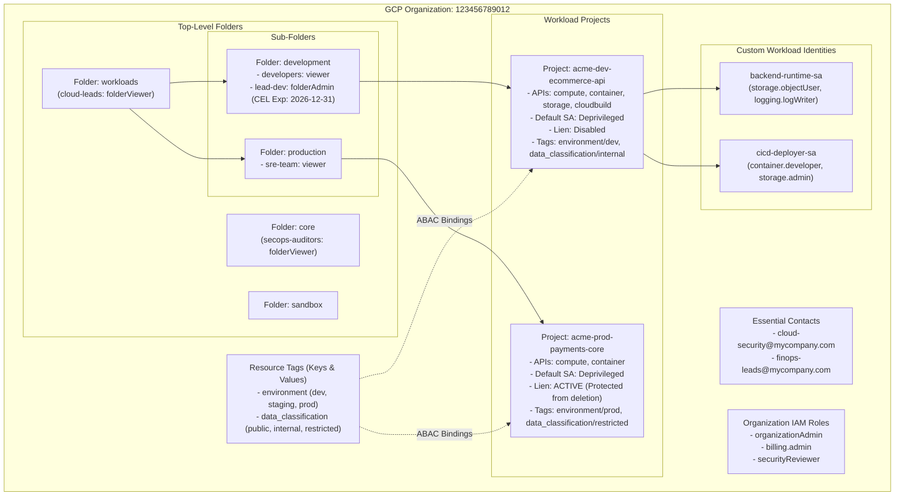

# GCP Foundation Infrastructure Example

[](https://www.terraform.io/)
[](https://cloud.google.com/)
[](#declarative-yaml-configuration)
[](#architecture-overview)

This example demonstrates how to bootstrap an enterprise Google Cloud Platform (GCP) Resource Hierarchy and Landing Zone using the declarative [foundation-infrastructure](file:///d:/GCP-DevOps-WorkSpace/gcp-terraform-custom-modules/foundation-infrastructure) module.

All organizational components—including **Essential Contacts**, cryptographic **Resource Tags**, **Top-Level Folders**, nested **Sub-Folders with Temporal CEL IAM Conditions**, dynamic **Workload Projects**, **Workload Identity Service Accounts**, and **Project Deletion Liens**—are declared within a single human-readable YAML configuration file: [hierarchy.yaml](file:///d:/GCP-DevOps-WorkSpace/gcp-terraform-custom-modules/examples/foundation/hierarchy.yaml).

---

## Table of Contents

- [Architecture Overview](#architecture-overview)
- [Directory Structure](#directory-structure)
- [Prerequisites & Permissions](#prerequisites--permissions)
- [Declarative YAML Configuration](#declarative-yaml-configuration)
  - [1. Essential Contacts](#1-essential-contacts)
  - [2. Resource Tags (Org-Level ABAC)](#2-resource-tags-org-level-abac)
  - [3. Root Organization IAM](#3-root-organization-iam)
  - [4. Folder Hierarchy & CEL IAM Conditions](#4-folder-hierarchy--cel-iam-conditions)
  - [5. Projects, Service Accounts & Deletion Liens](#5-projects-service-accounts--deletion-liens)
- [Deployment Workflow](#deployment-workflow)
  - [Step 1: Authenticate to GCP](#step-1-authenticate-to-gcp)
  - [Step 2: Update Configuration IDs](#step-2-update-configuration-ids)
  - [Step 3: Initialize Terraform](#step-3-initialize-terraform)
  - [Step 4: Plan Execution](#step-4-plan-execution)
  - [Step 5: Apply Configuration](#step-5-apply-configuration)
- [Module Outputs](#module-outputs)
- [Security & Governance Guardrails](#security--governance-guardrails)
- [Troubleshooting](#troubleshooting)

---

## Architecture Overview

The following diagram illustrates the resource hierarchy and governance boundaries provisioned by this example:



---

## Directory Structure

```
examples/foundation/
├── hierarchy.yaml     # Declarative enterprise landing zone definition
├── main.tf            # Instantiates the foundation-infrastructure module
├── outputs.tf         # Exposes folders, projects, SAs, and tag IDs
├── versions.tf        # Specifies required Terraform and provider versions
└── README.md          # Comprehensive deployment and architectural documentation
```

---

## Prerequisites & Permissions

To deploy the organization hierarchy, your identity (User Account or Terraform Automation Service Account) must possess the following GCP roles at the **Organization** or parent level:

| IAM Role | GCP Permission Identifiers | Purpose |
| :--- | :--- | :--- |
| **Organization Administrator** | `roles/resourcemanager.organizationAdmin` | Create top-level folders, manage organization IAM policies. |
| **Folder Administrator** | `roles/resourcemanager.folderAdmin` | Create and manage sub-folders and folder-level IAM bindings. |
| **Project Creator** | `roles/resourcemanager.projectCreator` | Provision projects dynamically under folders. |
| **Billing Account Administrator / User** | `roles/billing.admin` or `roles/billing.user` | Link newly created projects to the billing account. |
| **Tag Administrator** | `roles/resourcemanager.tagAdmin` | Provision Organization Tag Keys and Tag Values. |
| **Tag User** | `roles/resourcemanager.tagUser` | Bind tag values to projects for Attribute-Based Access Control (ABAC). |
| **Essential Contacts Admin** | `roles/essentialcontacts.admin` | Configure incident and security notification contacts. |

---

## Declarative YAML Configuration

The complete deployment specification is maintained in [hierarchy.yaml](file:///d:/GCP-DevOps-WorkSpace/gcp-terraform-custom-modules/examples/foundation/hierarchy.yaml). Below is an overview of each functional block:

### 1. Essential Contacts
Ensures Google Cloud automatically routes critical security, billing, and incident notifications to dedicated distribution lists without relying on individual project owners:
```yaml
essential_contacts:
  - email: "cloud-security@mycompany.com"
    notification_categories: ["SECURITY", "TECHNICAL"]
    language_tag: "en-US"
  - email: "finops-leads@mycompany.com"
    notification_categories: ["BILLING"]
    language_tag: "en-US"
```

### 2. Resource Tags (Org-Level ABAC)
Cryptographic tags provide tamper-proof metadata for Organization Policy evaluation and fine-grained IAM access control:
```yaml
tags:
  - key: "environment"
    description: "Deployment lifecycle stage"
    values: ["dev", "staging", "prod"]
  - key: "data_classification"
    description: "Data sensitivity classification"
    values: ["public", "internal", "restricted"]
```

### 3. Root Organization IAM
Grants enterprise administrator and auditor access using non-authoritative `google_organization_iam_member` resources to avoid overriding default organizational policies:
```yaml
organization_iam:
  - role: "roles/resourcemanager.organizationAdmin"
    members:
      - "group:gcp-org-admins@mycompany.com"
  - role: "roles/billing.admin"
    members:
      - "group:finops-leads@mycompany.com"
  - role: "roles/securityReviewer"
    members:
      - "group:secops-auditors@mycompany.com"
```

### 4. Folder Hierarchy & CEL IAM Conditions
Folder isolation cleanly separates environments. Supports Common Expression Language (CEL) conditions for temporary or conditional access:
```yaml
sub_folders:
  - name: "development"
    parent: "workloads"
    iam:
      - role: "roles/viewer"
        members: ["group:developers@mycompany.com"]
      # Temporal IAM Condition: Temporary Folder Admin access that expires
      - role: "roles/resourcemanager.folderAdmin"
        members: ["user:lead-dev@mycompany.com"]
        condition:
          title: "temporary_lead_access"
          description: "Expires Dec 31, 2026"
          expression: 'request.time < timestamp("2026-12-31T23:59:59Z")'
```

### 5. Projects, Service Accounts & Deletion Liens
Dynamic project factory handling API activation, automated tag bindings, default VPC suppression, default service account deprivileging, custom workload service accounts, and accidental deletion prevention:
```yaml
projects:
  - name: "ecommerce-api"
    prefix: "acme-dev"
    target_folder: "development"
    random_id: true
    auto_create_network: false          # Suppress default VPC (CIS recommended)
    deprivilege_default_sa: true
    lien: false
    apis:
      - "compute.googleapis.com"
      - "container.googleapis.com"
      - "storage.googleapis.com"
      - "cloudbuild.googleapis.com"
    tag_bindings:
      - "environment/dev"
      - "data_classification/internal"
    custom_service_accounts:
      - account_id: "backend-runtime-sa"
        display_name: "Backend Runtime Identity"
        roles:
          - "roles/storage.objectUser"
          - "roles/logging.logWriter"

  - name: "payments-core"
    prefix: "acme-prod"
    target_folder: "production"
    random_id: true
    auto_create_network: false          # Suppress default VPC (CIS recommended)
    deprivilege_default_sa: true
    lien: true                          # Hard deletion lien enabled
    apis:
      - "compute.googleapis.com"
      - "container.googleapis.com"
    tag_bindings:
      - "environment/prod"
      - "data_classification/restricted"
```

---

## Deployment Workflow

### Step 1: Authenticate to GCP
Authenticate with Application Default Credentials (ADC) using an account with Organization Administrator privileges:
```bash
gcloud auth login
gcloud auth application-default login
```

### Step 2: Update Configuration IDs
Edit [hierarchy.yaml](file:///d:/GCP-DevOps-WorkSpace/gcp-terraform-custom-modules/examples/foundation/hierarchy.yaml) and replace the placeholder values with your organization's actual identifiers and domain emails:
- `organization_id`: Your 12-digit GCP Organization ID (run `gcloud organizations list`).
- `billing_account_id`: Your GCP Billing Account ID (run `gcloud billing accounts list`).
- `members`: Replace placeholder emails (`*@mycompany.com`) with valid Google Groups or Cloud Identity accounts.

### Step 3: Initialize Terraform
Initialize Terraform to download the required provider plugins:
```bash
terraform init
```

### Step 4: Plan Execution
Preview the infrastructure changes before applying:
```bash
terraform plan
```

### Step 5: Apply Configuration
Provision the landing zone resources:
```bash
terraform apply
```

---

## Module Outputs

Once applied, the configuration exposes key metadata for downstream pipeline consumption:

| Output Name | Type | Description |
| :--- | :--- | :--- |
| `organization_id` | `string` | The target GCP Organization ID. |
| `folders` | `map(string)` | Map of folder names to their full GCP Resource IDs (`folders/XXXXX`). |
| `projects` | `map(object)` | Detailed summary of created projects including project IDs, numbers, and target folders. |
| `service_accounts` | `map(string)` | Map of generated custom service account IDs to their fully qualified email addresses. |
| `tag_keys` | `map(string)` | Map of created Tag Keys to their Resource Manager IDs (`tagKeys/XXXXX`). |
| `tag_values` | `map(string)` | Map of created Tag Values to their Resource Manager IDs (`tagValues/XXXXX`). |

To view outputs at any time:
```bash
terraform output
```

---

## Security & Governance Guardrails

1. **Default VPC Suppression (`auto_create_network: false`):**
   By setting `auto_create_network: false`, projects are initialized without the legacy `default` network, avoiding automatic creation of 10.128.0.0/9 subnets in all regions and eliminating default-allow ingress firewall rules.
2. **Default Service Account Deprivileging:**
   When `deprivilege_default_sa: true` is configured, the module automatically strips the overly permissive default `roles/editor` role from Compute Engine default service accounts (`{project_number}-compute@developer.gserviceaccount.com`).
3. **Accidental Deletion Liens:**
   Production workloads configure `lien: true`, establishing a `resourcemanager.projects.delete` lock. The project cannot be deleted via the Cloud Console, gcloud CLI, or Terraform until the lien is intentionally removed.
4. **Additive Non-Authoritative IAM:**
   All folder and project IAM policies are defined via `google_*_iam_member` resources, preventing accidental destruction of preexisting permissions, break-glass admin bindings, or Google-managed service identities.
5. **Cryptographic Tag Integrity:**
   Tag keys and tag values are anchored at the organization level, allowing downstream security teams to enforce Organization Policy Constraints (e.g., denying external IPs on projects tagged `environment/prod`).

---

## Troubleshooting

- **Error: `google_essential_contacts_contact: permission denied`**
  Ensure the caller has `roles/essentialcontacts.admin` on the root organization.
- **Error: `TagKey already exists`**
  Tag keys are globally unique per organization. If re-running across states, ensure tag names match existing unmanaged keys or clean them up via `gcloud resource-manager tags keys delete`.
- **Error deleting project with active lien:**
  To destroy a project with a lien enabled, first update `lien: false` in `hierarchy.yaml`, apply the change, and then proceed with deletion.

