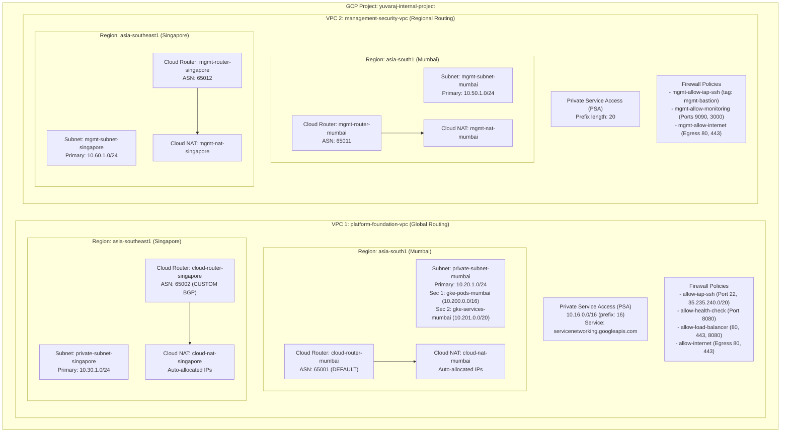

# Basic Multi-VPC Networking Example

[](https://www.terraform.io/)
[](https://cloud.google.com/)
[](#network-configuration-walkthrough)
[](#architecture-topology)

This example illustrates how to provision a production-grade, multi-VPC networking infrastructure on Google Cloud using the declarative [vpc-subnet-router-nat-firewall](file:///d:/GCP-DevOps-WorkSpace/gcp-terraform-custom-modules/networking-infrastructure/vpc-subnet-router-nat-firewall) custom module.

All networking topologies—including **VPC Networks**, **Regional Subnets with GKE Secondary Ranges**, **Cloud Routers with Custom BGP**, **Cloud NAT Gateways**, **Private Service Access (PSA)** for managed services (Cloud SQL, Memorystore), and **Stateful Ingress/Egress Firewall Rules**—are defined in [network-config.yaml](file:///d:/GCP-DevOps-WorkSpace/gcp-terraform-custom-modules/examples/network/basic-vpc-setup/network-config.yaml).

---

## Table of Contents

- [Architecture Topology](#architecture-topology)
- [Directory Structure](#directory-structure)
- [Prerequisites & Permissions](#prerequisites--permissions)
- [Network Configuration Walkthrough](#network-configuration-walkthrough)
  - [1. VPC 1: Platform Foundation VPC](#1-vpc-1-platform-foundation-vpc)
  - [2. VPC 2: Management & Security VPC](#2-vpc-2-management--security-vpc)
- [Deployment Workflow](#deployment-workflow)
  - [Step 1: Authenticate to GCP](#step-1-authenticate-to-gcp)
  - [Step 2: Configure Project & Region](#step-2-configure-project--region)
  - [Step 3: Initialize Terraform](#step-3-initialize-terraform)
  - [Step 4: Plan Deployment](#step-4-plan-deployment)
  - [Step 5: Apply Infrastructure](#step-5-apply-infrastructure)
- [Module Outputs](#module-outputs)
- [Verification & Validation](#verification--validation)
- [Troubleshooting](#troubleshooting)

---

## Architecture Topology

The example establishes two logically isolated VPC networks serving different tiers within an enterprise environment:



---

## Directory Structure

```
examples/network/basic-vpc-setup/
├── main.tf              # Calls the root networking module with network-config.yaml
├── network-config.yaml  # Complete multi-VPC, subnets, routers, NAT, and firewall rules
├── outputs.tf           # Exports structured summaries of all networking resources
├── provider.tf          # Terraform block and Google provider configuration
└── README.md            # Architectural design and deployment documentation
```

---

## Prerequisites & Permissions

Deploying this networking configuration requires an identity or Service Account with the following GCP IAM roles on the target project:

| IAM Role | GCP Permission Identifiers | Purpose |
| :--- | :--- | :--- |
| **Compute Network Admin** | `roles/compute.networkAdmin` | Create and manage VPCs, subnets, routers, NATs, and firewall rules. |
| **Compute Security Admin** | `roles/compute.securityAdmin` | Create, modify, and delete VPC firewall rules. |
| **Service Networking Admin** | `roles/servicenetworking.networksAdmin` | Create and maintain Private Service Access peerings with Google services. |
| **Service Usage Admin** | `roles/serviceusage.serviceUsageAdmin` | Ensure required Google APIs (`compute`, `servicenetworking`) are active. |

---

## Network Configuration Walkthrough

The [network-config.yaml](file:///d:/GCP-DevOps-WorkSpace/gcp-terraform-custom-modules/examples/network/basic-vpc-setup/network-config.yaml) file defines two distinct networks:

### 1. VPC 1: Platform Foundation VPC
Designed for primary business applications and Kubernetes (GKE) clusters:
- **Routing Mode:** `GLOBAL` — dynamically propagates routes between regions across the global Google backbone.
- **Private Service Access:** Allocates a `/16` CIDR block for internal Google services (e.g. Cloud SQL, Redis) with custom route import/export enabled.
- **Subnets:**
  - `private-subnet-mumbai` (`10.20.1.0/24` in `asia-south1`) with GKE secondary ranges:
    - Pods: `10.200.0.0/16`
    - Services: `10.201.0.0/20`
  - `private-subnet-singapore` (`10.30.1.0/24` in `asia-southeast1`)
- **Cloud Routers & NAT:** Cloud Routers in Mumbai (`ASN 65001`) and Singapore (`ASN 65002`) each backing a dedicated Cloud NAT gateway, providing secure outbound egress without assigning public external IPs to workloads.
- **Firewall Rules:**
  - `allow-iap-ssh`: Ingress SSH access strictly from Google Identity-Aware Proxy (IAP) netblock `35.235.240.0/20`.
  - `allow-health-check`: Ingress from Google Load Balancer health checkers (`130.211.0.0/22`, `35.191.0.0/16`).
  - `allow-load-balancer`: Web traffic ingress (ports 80, 443, 8080) for instances with the `allow-web` network tag.
  - `allow-internet`: Outbound HTTP/HTTPS egress for packages, dependencies, and external APIs.

### 2. VPC 2: Management & Security VPC
Dedicated to shared operations, bastion hosts, CI/CD runners, and observability tools:
- **Routing Mode:** `REGIONAL` — confines routing tables to their respective deployment regions.
- **Subnets:**
  - `mgmt-subnet-mumbai` (`10.50.1.0/24` in `asia-south1`)
  - `mgmt-subnet-singapore` (`10.60.1.0/24` in `asia-southeast1`)
- **Firewall Rules:**
  - `mgmt-allow-iap-ssh`: Dedicated bastion access via IAP for instances tagged `mgmt-bastion`.
  - `mgmt-allow-monitoring`: Cross-subnet observability metrics collection (Prometheus port 9090, Grafana port 3000) for instances tagged `monitoring`.
  - `mgmt-allow-internet`: Egress for telemetry forwarding and package updates.

---

## Deployment Workflow

### Step 1: Authenticate to GCP
```bash
gcloud auth login
gcloud auth application-default login
```

### Step 2: Configure Project & Region
Ensure your target GCP project ID in [network-config.yaml](file:///d:/GCP-DevOps-WorkSpace/gcp-terraform-custom-modules/examples/network/basic-vpc-setup/network-config.yaml) and [provider.tf](file:///d:/GCP-DevOps-WorkSpace/gcp-terraform-custom-modules/examples/network/basic-vpc-setup/provider.tf) matches your environment:
```yaml
project_id: your-gcp-project-id
region: asia-south1
```

### Step 3: Initialize Terraform
Download and initialize provider dependencies:
```bash
terraform init
```

### Step 4: Plan Deployment
Validate configurations and review the planned execution:
```bash
terraform plan
```

### Step 5: Apply Infrastructure
Provision the dual-VPC architecture:
```bash
terraform apply
```

---

## Module Outputs

Upon successful completion, the example exports rich diagnostic information:

| Output Name | Description |
| :--- | :--- |
| `vpc_summary` | Map of created VPCs including network IDs, self-links, and routing modes. |
| `subnet_summary` | Map of subnets including IP CIDR ranges, regions, gateway IPs, and secondary ranges. |
| `router_summary` | Summary of Cloud Routers, BGP ASNs, and advertisement modes. |
| `nat_summary` | Summary of Cloud NAT configurations and NAT IP allocation strategies. |
| `firewall_summary` | Map of configured firewall rules, directions, source/dest ranges, and applied tags. |
| `private_service_access_ranges` | Allocated reserved global IP ranges for Private Service Access. |
| `private_service_access_connections` | VPC Peering connection states with `servicenetworking.googleapis.com`. |

Inspect outputs anytime via:
```bash
terraform output -json
```

---

## Verification & Validation

1. **Verify VPC Networks:**
   ```bash
   gcloud compute networks list
   ```
2. **Verify Subnets & Secondary Ranges:**
   ```bash
   gcloud compute networks subnets list --network=platform-foundation-vpc
   ```
3. **Verify Cloud NAT Status:**
   ```bash
   gcloud compute routers nats list --router=cloud-router-mumbai --region=asia-south1
   ```
4. **Verify Private Service Access Peering:**
   ```bash
   gcloud compute networks peerings list --network=platform-foundation-vpc
   ```

---

## Troubleshooting

- **Error: `ServiceNetworking connection already exists`**
  GCP allows only one Service Networking connection per VPC. If an existing peering exists, either import it or remove the conflicting configuration before running Terraform.
- **Error: `Quota exceeded for IN_USE_ADDRESSES`**
  When provisioning multiple Cloud NATs with auto-allocated external IPs, verify that your project has adequate Compute Engine regional IP address quota.

