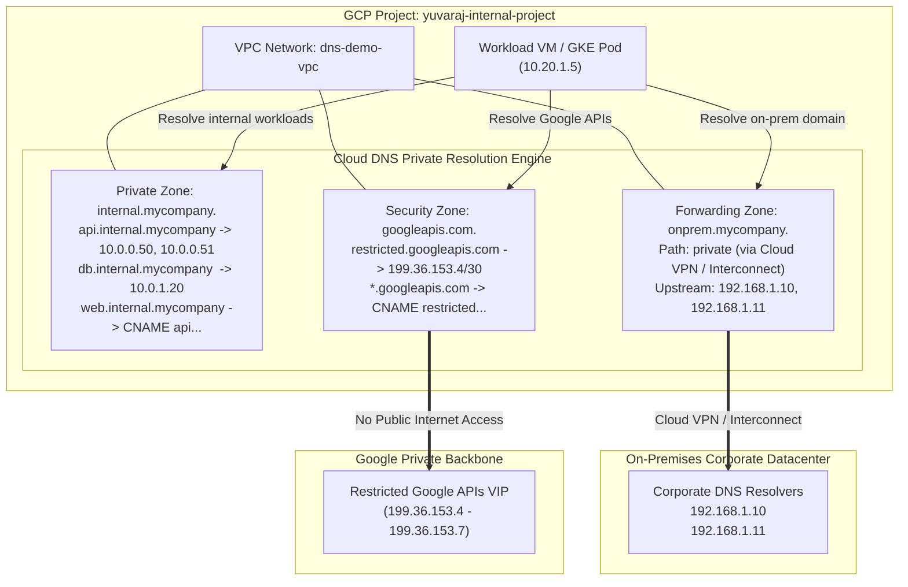

# Cloud DNS Architecture Example

[](https://www.terraform.io/)
[](https://cloud.google.com/)
[](#declarative-configuration-walkthrough)
[](#architecture-topology)

This example demonstrates how to implement an enterprise Google Cloud DNS architecture using the declarative [cloud-dns](file:///d:/GCP-DevOps-WorkSpace/gcp-terraform-custom-modules/networking-infrastructure/cloud-dns) custom module.

The deployment provisions a dedicated VPC network and binds three core DNS managed zones specified in [dns.yaml](file:///d:/GCP-DevOps-WorkSpace/gcp-terraform-custom-modules/examples/network/dns-setup/dns.yaml):
1. **Private Authoritative Zone (`internal.mycompany.`):** Internal microservices resolution (`api`, `db`, `web`).
2. **Hybrid DNS Forwarding Zone (`onprem.mycompany.`):** Private resolution of on-premises resources forwarded across Cloud VPN / Cloud Interconnect to corporate DNS resolvers (`192.168.1.10`, `192.168.1.11`).
3. **Restricted Google APIs Zone (`googleapis.com.`):** Resolves `*.googleapis.com` to Google's restricted Virtual IP range (`199.36.153.4/30`), enforcing zero-internet-egress API communications.

---

## Table of Contents

- [Architecture Topology](#architecture-topology)
- [Directory Structure](#directory-structure)
- [Prerequisites & Permissions](#prerequisites--permissions)
- [Declarative Configuration Walkthrough](#declarative-configuration-walkthrough)
  - [1. Private Authoritative Zone](#1-private-authoritative-zone)
  - [2. Hybrid On-Premises Forwarding Zone](#2-hybrid-on-premises-forwarding-zone)
  - [3. Restricted Google APIs Zone](#3-restricted-google-apis-zone)
- [Deployment Workflow](#deployment-workflow)
  - [Step 1: Authenticate to GCP](#step-1-authenticate-to-gcp)
  - [Step 2: Update Project & Domain Identifiers](#step-2-update-project--domain-identifiers)
  - [Step 3: Initialize Terraform](#step-3-initialize-terraform)
  - [Step 4: Plan Deployment](#step-4-plan-deployment)
  - [Step 5: Apply Configuration](#step-5-apply-configuration)
- [Module Outputs](#module-outputs)
- [Verification & Operational Testing](#verification--operational-testing)
- [Security & Architecture Best Practices](#security--architecture-best-practices)
- [Troubleshooting](#troubleshooting)

---

## Architecture Topology



---

## Directory Structure

```
examples/network/dns-setup/
├── dns.yaml          # Declarative DNS zones, forwarding targets, and records specification
├── main.tf           # Provisions demo VPC and instantiates cloud-dns custom module
├── outputs.tf        # Exports managed zone IDs, FQDNs, name servers, and records
├── provider.tf       # Google provider configuration and version constraints
└── README.md         # Architecture and deployment reference guide
```

---

## Prerequisites & Permissions

Deploying this example requires the following GCP IAM roles on your target project:

| IAM Role | GCP Permission Identifiers | Purpose |
| :--- | :--- | :--- |
| **DNS Administrator** | `roles/dns.admin` | Full control over Google Cloud DNS managed zones and record sets. |
| **Compute Network Admin** | `roles/compute.networkAdmin` | Provision base VPC network and bind DNS private visibility configs. |
| **Service Usage Admin** | `roles/serviceusage.serviceUsageAdmin` | Ensure `dns.googleapis.com` and `compute.googleapis.com` are active. |

---

## Declarative Configuration Walkthrough

All DNS configurations are maintained cleanly in [dns.yaml](file:///d:/GCP-DevOps-WorkSpace/gcp-terraform-custom-modules/examples/network/dns-setup/dns.yaml):

### 1. Private Authoritative Zone
Provides internal service discovery for workloads located in the attached VPC network:
```yaml
  - name: "internal-corp"
    dns_name: "internal.mycompany."
    description: "Private internal zone for microservices discovery"
    type: "private"
    records:
      - name: "api"
        type: "A"
        ttl: 300
        rrdatas: ["10.0.0.50", "10.0.0.51"]
      - name: "db"
        type: "A"
        ttl: 300
        rrdatas: ["10.0.1.20"]
      - name: "web"
        type: "CNAME"
        ttl: 300
        rrdatas: ["api.internal.mycompany."]
```

### 2. Hybrid On-Premises Forwarding Zone
Forwards queries for `onprem.mycompany.` across private network interconnects:
- **`type: "forwarding"`:** Delegates queries to external resolvers.
- **`forwarding_path: "private"`:** Uses Cloud VPN or Cloud Interconnect rather than routing queries over the public internet.
```yaml
  - name: "onprem-forwarding"
    dns_name: "onprem.mycompany."
    description: "Forwarding queries for on-premise resources"
    type: "forwarding"
    forwarding_path: "private"
    target_name_servers:
      - "192.168.1.10"
      - "192.168.1.11"
    records: []
```

### 3. Restricted Google APIs Zone
Enforces that Google Cloud APIs (Cloud Storage, BigQuery, Pub/Sub, etc.) route to Google's restricted Virtual IP range (`199.36.153.4/30`):
- Workloads in private subnets without public IPs or external NAT can securely communicate with Google APIs.
- Essential for zero-egress security perimeters (VPC Service Controls).
```yaml
  - name: "googleapis-restricted"
    dns_name: "googleapis.com."
    description: "Private routing for Google APIs"
    type: "private"
    records:
      - name: "restricted"
        type: "A"
        ttl: 300
        rrdatas:
          - "199.36.153.4"
          - "199.36.153.5"
          - "199.36.153.6"
          - "199.36.153.7"
      - name: "*"
        type: "CNAME"
        ttl: 300
        rrdatas: ["restricted.googleapis.com."]
```

---

## Deployment Workflow

### Step 1: Authenticate to GCP
Authenticate with Application Default Credentials (ADC):
```bash
gcloud auth login
gcloud auth application-default login
```

### Step 2: Update Project & Domain Identifiers
Edit [dns.yaml](file:///d:/GCP-DevOps-WorkSpace/gcp-terraform-custom-modules/examples/network/dns-setup/dns.yaml) and [provider.tf](file:///d:/GCP-DevOps-WorkSpace/gcp-terraform-custom-modules/examples/network/dns-setup/provider.tf) to match your GCP project ID and corporate domain names.

### Step 3: Initialize Terraform
```bash
terraform init
```

### Step 4: Plan Deployment
```bash
terraform plan
```

### Step 5: Apply Configuration
```bash
terraform apply
```

---

## Module Outputs

| Output Name | Type | Description |
| :--- | :--- | :--- |
| `vpc_network_name` | `string` | Name of the VPC network bound to private DNS zones. |
| `vpc_network_self_link` | `string` | Full self-link of the VPC network. |
| `managed_zones` | `map(object)` | Full attribute map of all created managed zones. |
| `zone_dns_names` | `map(string)` | Map of zone names to domain names (`dns_name`). |
| `name_servers` | `map(list(string))` | Assigned Cloud DNS name servers per zone. |
| `records` | `map(object)` | Map of provisioned DNS record sets. |
| `total_zones_count` | `number` | Total count of managed zones provisioned. |
| `total_records_count` | `number` | Total count of DNS record sets provisioned. |

Inspect all outputs:
```bash
terraform output -json
```

---

## Verification & Operational Testing

1. **List Cloud DNS Managed Zones:**
   ```bash
   gcloud dns managed-zones list --project=YOUR_PROJECT_ID
   ```
2. **Inspect Record Sets in Private Zone:**
   ```bash
   gcloud dns record-sets list --zone=internal-corp --project=YOUR_PROJECT_ID
   ```
3. **Verify Restricted Google APIs Zone:**
   ```bash
   gcloud dns record-sets list --zone=googleapis-restricted --project=YOUR_PROJECT_ID
   ```
4. **Test Resolution from a Workload VM:**
   SSH into an instance inside the attached VPC network and query the local resolver (`169.254.169.254`):
   ```bash
   # Test Private Authoritative Zone
   dig api.internal.mycompany. +short
   # Output: 10.0.0.50, 10.0.0.51

   # Test Restricted Google APIs Routing
   dig storage.googleapis.com +short
   # Output: restricted.googleapis.com. -> 199.36.153.4, ...
   ```

---

## Security & Architecture Best Practices

1. **Always Trailing Dots (`.`):**
   DNS zone names and CNAME targets must end with a trailing dot (`example.com.`). The module automatically sanitizes zone domain names, but maintaining strict trailing dots in your YAML ensures cross-platform consistency.
2. **Private Forwarding Path:**
   Always set `forwarding_path: "private"` when forwarding to on-premises IP addresses (`10.0.0.0/8`, `172.16.0.0/12`, `192.168.0.0/16`). Setting it to `"default"` attempts to route queries over the public internet, where RFC 1918 addresses are unroutable.
3. **Restricted Google APIs VIP:**
   Pairing the `googleapis-restricted` zone with a custom static route (`199.36.153.4/30` $\rightarrow$ `default-internet-gateway`) allows zero-egress environments to interact with Google APIs without NAT or public internet gateways.

---

## Troubleshooting

- **Error: `Invalid value for zone.dns_name`**
  DNS names must conform to RFC 1035 and end with a dot (`.`).
- **Error: `Network 'projects/.../networks/...' not found`**
  Ensure the VPC network referenced by `network_self_link` exists in the target project before applying.
- **Error: `Forwarding path 'private' requires Cloud VPN or Cloud Interconnect`**
  If testing without an active VPN tunnel to on-premise resolvers, set `forwarding_path: "default"` or omit the forwarding zone during local sandbox evaluation.

