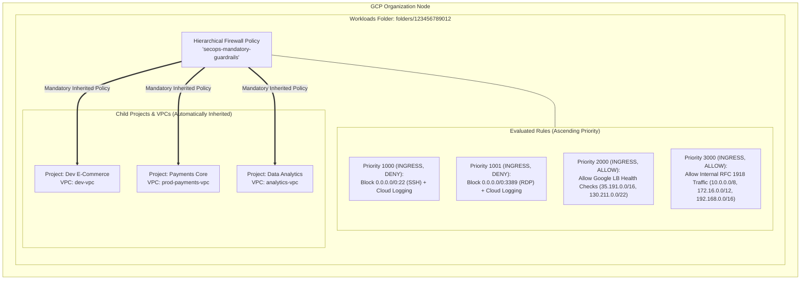

# Hierarchical Firewall Guardrails Example

[](https://www.terraform.io/)
[](https://cloud.google.com/)
[](#declarative-guardrails-configuration)
[](#architecture-overview)

This example demonstrates how to implement non-negotiable, organization-wide security guardrails across Google Cloud workloads using the declarative [hierarchical-firewalls](file:///d:/GCP-DevOps-WorkSpace/gcp-terraform-custom-modules/networking-infrastructure/hierarchical-firewalls) module.

By attaching firewall policies at the **Folder** (e.g. Workloads / Production) or **Organization** root, central SecOps teams enforce critical ingress/egress rules that take absolute precedence over local VPC firewall rules managed by individual project developers.

All guardrails—including universal internet SSH/RDP blocks, health check allowances, and RFC 1918 mesh communication—are specified declaratively in [firewalls.yaml](file:///d:/GCP-DevOps-WorkSpace/gcp-terraform-custom-modules/examples/network/firewall-setup/firewalls.yaml).

---

## Table of Contents

- [Architecture Overview](#architecture-overview)
- [Directory Structure](#directory-structure)
- [Prerequisites & Permissions](#prerequisites--permissions)
- [Declarative Guardrails Configuration](#declarative-guardrails-configuration)
  - [Rule 1: Block Public SSH (0.0.0.0/0:22)](#rule-1-block-public-ssh-0000022)
  - [Rule 2: Block Public RDP (0.0.0.0/0:3389)](#rule-2-block-public-rdp-000003389)
  - [Rule 3: Allow Google Cloud Health Checks](#rule-3-allow-google-cloud-health-checks)
  - [Rule 4: Allow Corporate RFC 1918 Private Traffic](#rule-4-allow-corporate-rfc-1918-private-traffic)
- [Deployment Workflow](#deployment-workflow)
  - [Step 1: Authenticate to GCP](#step-1-authenticate-to-gcp)
  - [Step 2: Update Target Folder or Organization ID](#step-2-update-target-folder-or-organization-id)
  - [Step 3: Initialize Terraform](#step-3-initialize-terraform)
  - [Step 4: Plan Deployment](#step-4-plan-deployment)
  - [Step 5: Apply Configuration](#step-5-apply-configuration)
- [Module Outputs](#module-outputs)
- [Verification & Operational Auditing](#verification--operational-auditing)
- [Troubleshooting](#troubleshooting)

---

## Architecture Overview

The diagram below illustrates how hierarchical firewall policies attach to parent hierarchy nodes and automatically protect child folders, projects, and VPCs:



---

## Directory Structure

```
examples/network/firewall-setup/
├── firewalls.yaml    # Declarative guardrails specification (target node, rules, logging)
├── main.tf           # Instantiates the hierarchical-firewalls custom module
├── outputs.tf        # Exposes policy IDs, attachment targets, and rule summaries
├── provider.tf       # Google provider configuration and version constraints
└── README.md         # Architecture and deployment reference guide
```

---

## Prerequisites & Permissions

Because hierarchical firewall policies attach to Organization or Folder resource nodes, deploying requires permissions above the project level:

| IAM Role | Level | Purpose |
| :--- | :--- | :--- |
| **Hierarchical Firewall Policy Admin** (`roles/compute.orgFirewallPolicyAdmin`) | Target Organization or Folder | Create, modify, and associate hierarchical policies. |
| **Organization Security Policy Admin** (`roles/compute.orgSecurityPolicyAdmin`) | Target Organization or Folder | Alternative full security administrator role. |
| **Folder Admin** or **Org Admin** (`roles/resourcemanager.folderAdmin` / `roles/resourcemanager.organizationAdmin`) | Target Node | Read target folder/organization metadata. |

---

## Declarative Guardrails Configuration

The security policy is fully configured in [firewalls.yaml](file:///d:/GCP-DevOps-WorkSpace/gcp-terraform-custom-modules/examples/network/firewall-setup/firewalls.yaml):

```yaml
# Target attachment: "folder" or "organization"
parent_type: "folder"
parent_id: "123456789012" # Target Folder ID (e.g. Workloads folder)

policy_name: "secops-mandatory-guardrails"
description: "Non-negotiable organization-wide firewall guardrails"

rules:
  ...
```

### Rule 1: Block Public SSH (0.0.0.0/0:22)
- **Priority:** `1000` | **Action:** `deny` | **Logging:** `true`
- **Rationale:** Prohibits direct SSH brute-force exposure from the public internet. Legitimate administrative access must occur through Google Identity-Aware Proxy (IAP) or VPN.
- **Audit Value:** Enabling Cloud Logging on this rule streams violation events to Cloud Logging and SIEM tools for real-time intruder monitoring.

### Rule 2: Block Public RDP (0.0.0.0/0:3389)
- **Priority:** `1001` | **Action:** `deny` | **Logging:** `true`
- **Rationale:** Blocks Windows Remote Desktop exposures from untrusted external networks.

### Rule 3: Allow Google Cloud Health Checks
- **Priority:** `2000` | **Action:** `allow` | **Logging:** `false`
- **Rationale:** Explicitly permits probe traffic from Google Cloud Global and Regional Load Balancers (`35.191.0.0/16`, `130.211.0.0/22`), ensuring services behind Cloud Load Balancers remain healthy.

### Rule 4: Allow Corporate RFC 1918 Private Traffic
- **Priority:** `3000` | **Action:** `allow` | **Logging:** `false`
- **Rationale:** Whitelists all RFC 1918 private subnets (`10.0.0.0/8`, `172.16.0.0/12`, `192.168.0.0/16`) across peered VPCs, Cloud Interconnects, and Shared VPC networks.

---

## Deployment Workflow

### Step 1: Authenticate to GCP
Authenticate with credentials possessing `roles/compute.orgFirewallPolicyAdmin` at the parent folder or organization level:
```bash
gcloud auth login
gcloud auth application-default login
```

### Step 2: Update Target Folder or Organization ID
Edit [firewalls.yaml](file:///d:/GCP-DevOps-WorkSpace/gcp-terraform-custom-modules/examples/network/firewall-setup/firewalls.yaml):
- Set `parent_type` to `"folder"` or `"organization"`.
- Set `parent_id` to your numerical target ID (run `gcloud resource-manager folders list --organization=ORGANIZATION_ID`).

### Step 3: Initialize Terraform
```bash
terraform init
```

### Step 4: Plan Deployment
```bash
terraform plan
```

### Step 5: Apply Configuration
Provision the policy, rules, and folder association:
```bash
terraform apply
```

---

## Module Outputs

| Output Name | Type | Description |
| :--- | :--- | :--- |
| `policy_id` | `string` | Unique resource ID of the hierarchical policy container. |
| `policy_name` | `string` | Short name (`secops-mandatory-guardrails`). |
| `attached_target` | `string` | Resource URI (`folders/123456789012` or `organizations/123456789012`). |
| `association_id` | `string` | Resource ID of the folder/organization association. |
| `configured_rule_priorities` | `list(number)` | List of configured rule priorities (`[1000, 1001, 2000, 3000]`). |
| `rules_summary` | `map(object)` | Detailed summary of each provisioned rule. |

Display outputs via:
```bash
terraform output -json
```

---

## Verification & Operational Auditing

1. **List Hierarchical Policies:**
   ```bash
   gcloud compute firewall-policies list --folder=FOLDER_ID
   ```
2. **Describe Policy Rules:**
   ```bash
   gcloud compute firewall-policies describe secops-mandatory-guardrails
   ```
3. **Verify Node Associations:**
   ```bash
   gcloud compute firewall-policies associations list --folder=FOLDER_ID
   ```
4. **Inspect Cloud Logging for Blocked Connections:**
   Query the Cloud Logging console or CLI for dropped connection logs:
   ```
   resource.type="gce_subnetwork"
   jsonPayload.disposition="DENY"
   jsonPayload.rule_details.priority=1000
   ```

---

## Troubleshooting

- **Error: `Permission 'compute.firewallPolicies.create' denied on resource`**
  Verify your identity has `roles/compute.orgFirewallPolicyAdmin` at the Folder or Organization parent level.
- **Error: `Policy short_name already exists`**
  Hierarchical firewall policy short names must be unique within an organization. If a previous run failed or exists unmanaged, update `policy_name` in [firewalls.yaml](file:///d:/GCP-DevOps-WorkSpace/gcp-terraform-custom-modules/examples/network/firewall-setup/firewalls.yaml).
- **Error: `Dependency cycle or rules unattached`**
  The module enforces `depends_on = [google_compute_firewall_policy_rule.rules]` on policy association, ensuring rules are in place before association takes effect.

