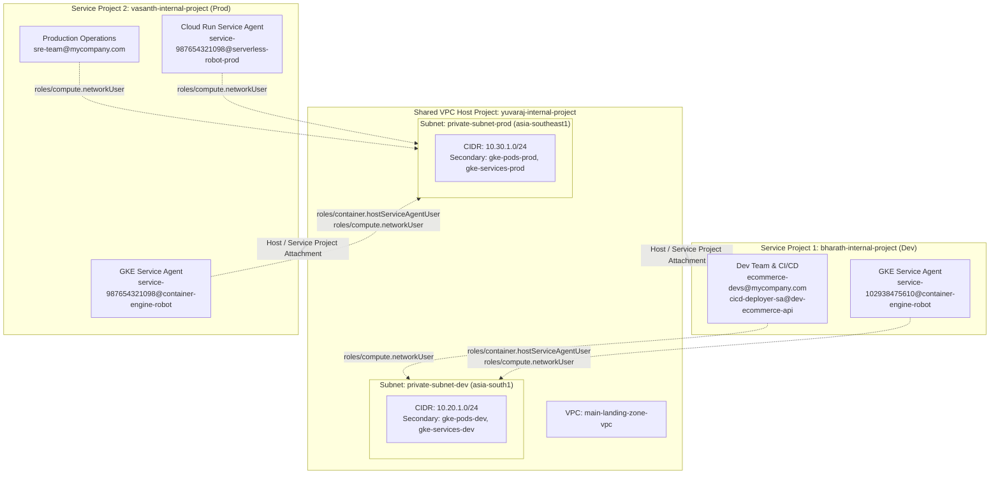

# Shared VPC Cross-Project Networking Example

[](https://www.terraform.io/)
[](https://cloud.google.com/)
[](#two-stage-configuration-architecture)
[](#architecture-topology)

This example demonstrates how to implement an enterprise **Shared VPC (Cross-Project Networking)** architecture on Google Cloud by orchestrating two composable modules:
1. [vpc-subnet-router-nat-firewall](file:///d:/GCP-DevOps-WorkSpace/gcp-terraform-custom-modules/networking-infrastructure/vpc-subnet-router-nat-firewall): Provisions the core Host VPC, subnets with secondary ranges, Cloud Routers, Cloud NATs, Private Service Access, and baseline firewall rules.
2. [shared-vpc](file:///d:/GCP-DevOps-WorkSpace/gcp-terraform-custom-modules/networking-infrastructure/shared-vpc): Enables the Host Project, binds Service Projects, automatically configures Managed Service Agents (GKE & Cloud Run), and enforces least-privilege Subnet IAM delegations (`roles/compute.networkUser`).

Both stages are driven cleanly through declarative YAML files: [network-config.yaml](file:///d:/GCP-DevOps-WorkSpace/gcp-terraform-custom-modules/examples/network/shared-vpc-setup/network-config.yaml) and [shared_vpc.yaml](file:///d:/GCP-DevOps-WorkSpace/gcp-terraform-custom-modules/examples/network/shared-vpc-setup/shared_vpc.yaml).

---

## Table of Contents

- [Architecture Topology](#architecture-topology)
- [Directory Structure](#directory-structure)
- [Prerequisites & Permissions](#prerequisites--permissions)
- [Two-Stage Configuration Architecture](#two-stage-configuration-architecture)
  - [Stage 1: Base VPC Networking (1-vpc.tf)](#stage-1-base-vpc-networking-1-vpctf)
  - [Stage 2: Shared VPC Orchestration (2-shared-vpc.tf)](#stage-2-shared-vpc-orchestration-2-shared-vpctf)
- [Deployment Workflow](#deployment-workflow)
  - [Step 1: Authenticate to GCP](#step-1-authenticate-to-gcp)
  - [Step 2: Update Configuration Identifiers](#step-2-update-configuration-identifiers)
  - [Step 3: Initialize Terraform](#step-3-initialize-terraform)
  - [Step 4: Review Execution Plan](#step-4-review-execution-plan)
  - [Step 5: Apply Configuration](#step-5-apply-configuration)
- [Module Outputs](#module-outputs)
- [Security & Isolation Model](#security--isolation-model)
- [Troubleshooting](#troubleshooting)

---

## Architecture Topology

The diagram below illustrates how the Host Project and attached Service Projects interact, including automated Service Agent permissions and isolated subnet delegations:



---

## Directory Structure

```
examples/network/shared-vpc-setup/
├── 1-vpc.tf             # Stage 1: Provisions core Host VPC, subnets, routers, NATs
├── 2-shared-vpc.tf      # Stage 2: Enables Host, attaches Service Projects, grants Subnet IAM
├── network-config.yaml  # Base networking definition for the Host VPC
├── shared_vpc.yaml      # Service project mappings, service agent flags, and Subnet IAM
├── outputs.tf           # Exports networking summaries and Shared VPC attachment metrics
├── provider.tf          # Terraform block and Google provider configuration
└── README.md            # Architecture and operational deployment guide
```

---

## Prerequisites & Permissions

Because Shared VPC spans multiple GCP projects, the deploying identity or automation runner requires permissions at both the **Organization / Folder** and **Project** levels:

| IAM Role | Level | Purpose |
| :--- | :--- | :--- |
| **Shared VPC Admin** | Organization / Folder (`roles/compute.xpnAdmin`) | Enable Host Project and attach Service Projects to the Shared VPC. |
| **Compute Network Admin** | Host Project (`roles/compute.networkAdmin`) | Create and manage subnets, routes, and assign Subnet-level IAM permissions. |
| **Security Admin** | Host Project (`roles/compute.securityAdmin`) | Manage firewall rules in the Host VPC network. |
| **Project IAM Admin** | Host Project (`roles/resourcemanager.projectIamAdmin`) | Grant `roles/container.hostServiceAgentUser` to service project GKE robots at project level. |

---

## Two-Stage Configuration Architecture

### Stage 1: Base VPC Networking ([1-vpc.tf](file:///d:/GCP-DevOps-WorkSpace/gcp-terraform-custom-modules/examples/network/shared-vpc-setup/1-vpc.tf))
Calls `networking-infrastructure/vpc-subnet-router-nat-firewall` reading [network-config.yaml](file:///d:/GCP-DevOps-WorkSpace/gcp-terraform-custom-modules/examples/network/shared-vpc-setup/network-config.yaml):
- Provisions `main-landing-zone-vpc`.
- Creates `private-subnet-dev` (`10.20.1.0/24`) and `private-subnet-prod` (`10.30.1.0/24`) with secondary IP ranges for Kubernetes Pods and Services.
- Establishes Cloud Routers and Cloud NATs in `asia-south1` and `asia-southeast1`.
- Configures Private Service Access (PSA) and standard ingress/egress firewall rules.

### Stage 2: Shared VPC Orchestration ([2-shared-vpc.tf](file:///d:/GCP-DevOps-WorkSpace/gcp-terraform-custom-modules/examples/network/shared-vpc-setup/2-shared-vpc.tf))
Calls `networking-infrastructure/shared-vpc` reading [shared_vpc.yaml](file:///d:/GCP-DevOps-WorkSpace/gcp-terraform-custom-modules/examples/network/shared-vpc-setup/shared_vpc.yaml):
- **Host Enablement:** Registers `yuvaraj-internal-project` as a Shared VPC Host Project.
- **Service Project Attachments:**
  - `bharath-internal-project` attached and granted access to `private-subnet-dev`.
  - `vasanth-internal-project` attached and granted access to `private-subnet-prod`.
- **Automated Service Agent IAM:**
  - Derives GKE Robot identities (`service-{project_number}@container-engine-robot.iam.gserviceaccount.com`) and binds `roles/container.hostServiceAgentUser` (Host Project) + `roles/compute.networkUser` (Allowed Subnet).
  - Derives Cloud Run Robot identities (`service-{project_number}@serverless-robot-prod.iam.gserviceaccount.com`) and binds `roles/compute.networkUser` on the production subnet.
- **Custom Subnet IAM:**
  - Delegates developer groups and CI/CD deployers strictly to `private-subnet-dev`.
  - Delegates SRE teams strictly to `private-subnet-prod`.

```yaml
host_project_id: "yuvaraj-internal-project"

service_projects:
  - project_id: "bharath-internal-project"
    project_number: "102938475610"
    enable_gke: true
    enable_cloud_run: false
    allowed_subnets:
      - name: "private-subnet-dev"
        region: "asia-south1"

  - project_id: "vasanth-internal-project"
    project_number: "987654321098"
    enable_gke: true
    enable_cloud_run: true
    allowed_subnets:
      - name: "private-subnet-prod"
        region: "asia-southeast1"

custom_subnet_iam:
  - subnet_name: "private-subnet-dev"
    region: "asia-south1"
    members:
      - "group:ecommerce-devs@mycompany.com"
      - "serviceAccount:cicd-deployer-sa@dev-ecommerce-api.iam.gserviceaccount.com"

  - subnet_name: "private-subnet-prod"
    region: "asia-southeast1"
    members:
      - "group:sre-team@mycompany.com"
```

---

## Deployment Workflow

### Step 1: Authenticate to GCP
Authenticate with credentials that hold `compute.xpnAdmin` at the folder/organization level:
```bash
gcloud auth login
gcloud auth application-default login
```

### Step 2: Update Configuration Identifiers
Edit [network-config.yaml](file:///d:/GCP-DevOps-WorkSpace/gcp-terraform-custom-modules/examples/network/shared-vpc-setup/network-config.yaml) and [shared_vpc.yaml](file:///d:/GCP-DevOps-WorkSpace/gcp-terraform-custom-modules/examples/network/shared-vpc-setup/shared_vpc.yaml):
- Set `host_project_id` to your actual Host Project ID.
- Provide real project IDs and project numbers for `service_projects`.
- Update user, group, or service account identifiers under `custom_subnet_iam`.

### Step 3: Initialize Terraform
```bash
terraform init
```

### Step 4: Review Execution Plan
Verify the two-stage execution sequence:
```bash
terraform plan
```

### Step 5: Apply Configuration
```bash
terraform apply
```

Terraform automatically respects the dependency graph: base subnets in `module.vpc-networking` are provisioned first, followed by Host activation and Subnet IAM bindings in `module.shared_vpc`.

---

## Module Outputs

The deployment provides full visibility into both the network tier and Shared VPC bindings:

| Output Name | Source | Description |
| :--- | :--- | :--- |
| `host_project_id` | `module.shared_vpc` | Project ID enabled as the Shared VPC Host. |
| `attached_service_projects` | `module.shared_vpc` | List of Service Project IDs successfully attached. |
| `configured_subnet_delegations`| `module.shared_vpc` | Total count of `roles/compute.networkUser` IAM delegations created. |
| `service_project_attachments` | `module.shared_vpc` | Detailed map of attachment resources and IDs. |
| `vpc_summary` | `module.vpc-networking` | Summary of the Host VPC network. |
| `subnet_summary` | `module.vpc-networking` | Summary of primary subnets and secondary IP ranges. |
| `router_summary` | `module.vpc-networking` | Cloud Router and BGP states. |
| `nat_summary` | `module.vpc-networking` | Cloud NAT gateway metrics. |
| `firewall_summary` | `module.vpc-networking` | Configured firewall rules in the Host VPC. |

---

## Security & Isolation Model

1. **Subnet-Level Least Privilege:**
   Rather than granting `roles/compute.networkUser` at the entire Host Project level, permissions are scoped strictly per individual subnet (`google_compute_subnetwork_iam_member`). Dev workloads cannot attach to or observe production subnets.
2. **Automated Robot Identity Management:**
   Managed service identities (GKE Container Engine Robot, Cloud Run Serverless Robot) are automatically synthesized from the `project_number` attribute, eliminating manual permission guesswork and race conditions.
3. **Explicit Dependency Ordering:**
   `2-shared-vpc.tf` declares `depends_on = [module.vpc-networking]`, ensuring subnets exist prior to IAM binding creation and preventing API race conditions.

---

## Troubleshooting

- **Error: `Constraint constraints/compute.restrictSharedVpcHostProjects violated`**
  Your organization may enforce an Org Policy restricting which projects can be Host Projects. Ensure the Host Project is in the allowed list of the policy.
- **Error: `Required 'compute.organizations.enableXpnHost' permission`**
  The user/service account running Terraform must have `roles/compute.xpnAdmin` at the Organization or Folder containing both the host and service projects.
- **Error: `Subnetwork not found`**
  Verify that the `name` and `region` attributes defined under `allowed_subnets` and `custom_subnet_iam` in [shared_vpc.yaml](file:///d:/GCP-DevOps-WorkSpace/gcp-terraform-custom-modules/examples/network/shared-vpc-setup/shared_vpc.yaml) match the subnets defined in [network-config.yaml](file:///d:/GCP-DevOps-WorkSpace/gcp-terraform-custom-modules/examples/network/shared-vpc-setup/network-config.yaml).

