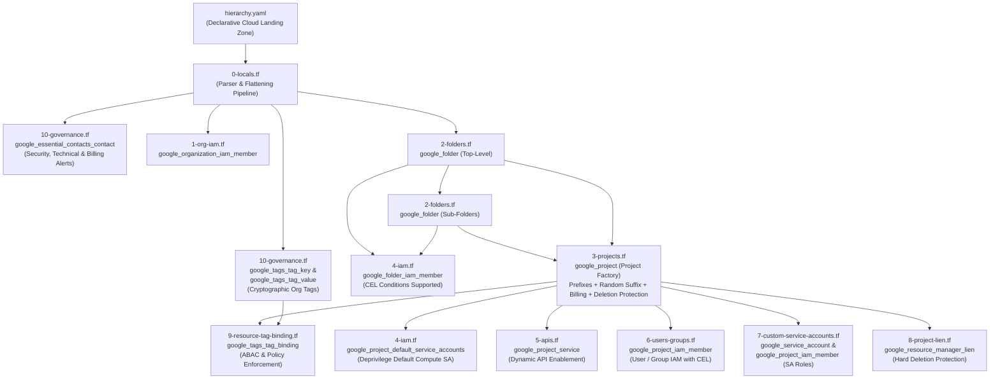
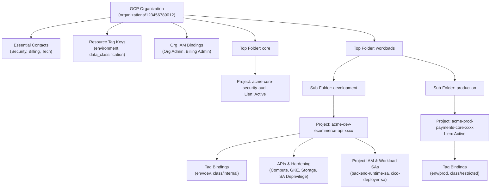

# GCP Foundation Infrastructure & Project Factory Module

[](https://www.terraform.io/)
[](https://registry.terraform.io/providers/hashicorp/google/latest)
[](https://registry.terraform.io/providers/hashicorp/random/latest)
[](LICENSE)

An enterprise-grade, YAML-driven Terraform foundation module for Google Cloud Platform (GCP). This module automates the provisioning of your end-to-end cloud resource hierarchy, implementing the **Project Factory** pattern, multi-tier folder structures, dynamic API activation, granular IAM governance with CEL conditions, custom workload service accounts, organizational governance (Essential Contacts & Resource Tags), and multi-layer security guardrails (Service Account Deprivileging & Project Deletion Liens).

---

## Architecture Overview



### Resource Hierarchy Model



---

## Key Features

1. **Declarative Hierarchy (`hierarchy.yaml`)**:
   - Manage your entire cloud foundation—from essential contacts and tag taxonomies down to project service accounts and liens—in a version-controlled YAML specification.
2. **Organization Governance & Essential Contacts (`10-governance.tf`)**:
   - Centralizes Google Cloud notifications for security, billing, and incident response by routing alerts to verified organizational contacts and distribution lists.
   - Creates centralized **Resource Manager Tag Keys & Tag Values** at the organization root. Unlike metadata labels, cryptographic tags cannot be tampered with by project-level users and can be evaluated in IAM conditions and Organization Policies.
3. **Multi-Tier Folder Architecture (`2-folders.tf`)**:
   - Automated creation of top-level folders parented by the GCP Organization and nested sub-folders parented by top-level folders.
4. **Enterprise Project Factory (`3-projects.tf` & `0-locals.tf`)**:
   - Automated project provisioning placed under designated target folders.
   - Built-in naming conventions: configurable prefix, base name, and optional randomized 4-character suffix (`random_string.project_suffix`) to ensure global project ID uniqueness.
   - Automatic billing account association.
   - Metadata labels for FinOps and organizational cost center attribution.
   - Config-level deletion protection (`deletion_policy = "PREVENT"`) to avoid accidental loss.
5. **Multi-Layer Deletion Protection & Project Liens (`8-project-lien.tf`)**:
   - Optional `lien: true` applies a **GCP Resource Manager Lien** (`resourcemanager.projects.delete`), enforcing hard deletion protection that physically blocks project deletion in the Google Cloud Console, gcloud CLI, or API calls until the lien is deliberately removed.
6. **Cryptographic Tag Bindings (`9-resource-tag-binding.tf`)**:
   - Attaches organization-level tag values directly to provisioned projects, unlocking Attribute-Based Access Control (ABAC), fine-grained IAM conditions, and organization policy inheritance.
7. **Security Hardening by Default (`4-iam.tf`)**:
   - **Deprivilege Default Service Accounts**: Automatically removes the default over-privileged `roles/editor` binding from the default Compute Engine service account (`{project_number}-compute@developer.gserviceaccount.com`), enforcing least-privilege baselines across all new projects.
8. **Granular IAM with CEL Conditions (`1-org-iam.tf`, `4-iam.tf`, `6-users-groups.tf`)**:
   - Non-authoritative IAM member bindings across Organization, Folders, and Projects.
   - Full support for Common Expression Language (CEL) IAM conditions (e.g., time-bound temporary access, IP constraints, resource tags).
9. **Dynamic API & Service Enablement (`5-apis.tf`)**:
   - Project-by-project API activation.
   - Safe destroy protection: sets `disable_on_destroy = false` and `disable_dependent_services = false` to prevent unexpected service disruption during configuration changes.
10. **Custom Workload Service Accounts (`7-custom-service-accounts.tf`)**:
    - Provisions dedicated service accounts per project for application workloads, Google Kubernetes Engine (GKE) Workload Identity, or CI/CD pipelines.
    - Automatically binds specified IAM roles to custom service accounts within their target project.

---

## File Structure & Module Breakdown

| File | Purpose | Managed Resources |
|---|---|---|
| [`0-locals.tf`](./0-locals.tf) | YAML configuration parsing, data transformation, and schema flattening pipeline | Local variables & collections |
| [`1-org-iam.tf`](./1-org-iam.tf) | Organization-level IAM member bindings | `google_organization_iam_member.org` |
| [`2-folders.tf`](./2-folders.tf) | Top-level folders and nested sub-folder hierarchy | `google_folder.top`, `google_folder.sub` |
| [`3-projects.tf`](./3-projects.tf) | Project Factory creating projects with billing, prefix, and random suffix | `random_string.project_suffix`, `google_project.projects` |
| [`4-iam.tf`](./4-iam.tf) | Folder IAM bindings with CEL conditions & default SA deprivileging | `google_folder_iam_member.folders`, `google_project_default_service_accounts.deprivilege` |
| [`5-apis.tf`](./5-apis.tf) | Dynamic GCP service and API enablement per project | `google_project_service.apis` |
| [`6-users-groups.tf`](./6-users-groups.tf) | Project-level IAM bindings for users, groups, and service accounts | `google_project_iam_member.users` |
| [`7-custom-service-accounts.tf`](./7-custom-service-accounts.tf) | Workload service account creation and project IAM role assignments | `google_service_account.sa`, `google_project_iam_member.sa_roles` |
| [`8-project-lien.tf`](./8-project-lien.tf) | Resource Manager Liens for hard deletion protection | `google_resource_manager_lien.project_lien` |
| [`9-resource-tag-binding.tf`](./9-resource-tag-binding.tf) | Cryptographic Resource Tag bindings for ABAC and policy enforcement | `google_tags_tag_binding.project_tags` |
| [`10-governance.tf`](./10-governance.tf) | Organization Essential Contacts and Resource Tag Keys & Values taxonomy | `google_essential_contacts_contact.contacts`, `google_tags_tag_key.keys`, `google_tags_tag_value.values` |
| [`variables.tf`](./variables.tf) | Input variables for configuration path | Variable `yaml_config_path` |
| [`outputs.tf`](./outputs.tf) | Exported outputs for folder IDs, projects, service accounts, and tag keys/values | Outputs `organization_id`, `folders`, `projects`, etc. |
| [`versions.tf`](./versions.tf) | Terraform version and provider constraints | Providers `hashicorp/google`, `hashicorp/random` |

---

## Requirements

| Name | Version |
|---|---|
| <a name="requirement_terraform"></a> [terraform](#requirement\_terraform) | `>= 1.5.0` |
| <a name="requirement_google"></a> [google](#requirement\_google) | `>= 5.0.0, < 7.0.0` |
| <a name="requirement_random"></a> [random](#requirement\_random) | `>= 3.5.0` |

---

## Inputs

| Name | Description | Type | Default | Required |
|---|---|---|---|:---:|
| `yaml_config_path` | Path to the hierarchy YAML configuration file defining org IAM, folder hierarchy, projects, APIs, and service accounts. | `string` | `"./hierarchy.yaml"` | no |

---

## Outputs

| Name | Description | Type |
|---|---|---|
| `organization_id` | Target GCP Organization ID specified in configuration. | `string` |
| `folders` | Lookup map from folder display name to GCP resource ID (e.g. `'workloads' => 'folders/123456789012'`). | `map(string)` |
| `projects` | Summary map of created projects including project `id`, `number`, and parent `folder`. | `map(object)` |
| `service_accounts` | Map of created custom service accounts (keyed as `'<project_name>-<account_id>'`) to their generated email addresses. | `map(string)` |
| `tag_keys` | Lookup map of created Resource Tag keys to their GCP resource IDs. | `map(string)` |
| `tag_values` | Lookup map of created Resource Tag values to their GCP resource IDs. | `map(string)` |

---

## YAML Configuration Reference (`hierarchy.yaml`)

The module is driven entirely by a YAML configuration file. Below is the comprehensive schema specification:

```yaml
# Target GCP Organization & Billing Account
organization_id: "123456789012"
billing_account_id: "012345-56789A-BCDEF0"

# ------------------------------------------------------------------------------
# 1. ESSENTIAL CONTACTS (Incident, security, and billing alerts)
# ------------------------------------------------------------------------------
essential_contacts:
  - email: "cloud-security@mycompany.com"
    notification_categories: ["SECURITY", "TECHNICAL"]
    language_tag: "en-US"
  - email: "finops-leads@mycompany.com"
    notification_categories: ["BILLING"]
    language_tag: "en-US"

# ------------------------------------------------------------------------------
# 2. GCP RESOURCE TAGS (Cryptographic tags for ABAC & Org Policies)
# ------------------------------------------------------------------------------
tags:
  - key: "environment"
    description: "Deployment lifecycle stage"
    values: ["dev", "staging", "prod"]
  - key: "data_classification"
    description: "Data sensitivity classification"
    values: ["public", "internal", "restricted"]

# ------------------------------------------------------------------------------
# 3. ROOT ORGANIZATION IAM
# ------------------------------------------------------------------------------
organization_iam:
  - role: "roles/resourcemanager.organizationAdmin"
    members:
      - "group:gcp-org-admins@mycompany.com"
  - role: "roles/billing.admin"
    members:
      - "group:finops-leads@mycompany.com"
  - role: "roles/securityReviewer"
    members:
      - "group:secops-auditors@mycompany.com"

# ------------------------------------------------------------------------------
# 4. TOP-LEVEL FOLDERS (Parent: Organization Root)
# ------------------------------------------------------------------------------
top_level_folders:
  - name: "core"
    iam:
      - role: "roles/resourcemanager.folderViewer"
        members: ["group:secops-auditors@mycompany.com"]
  - name: "workloads"
    iam:
      - role: "roles/resourcemanager.folderViewer"
        members: ["group:cloud-leads@mycompany.com"]
  - name: "sandbox"
    iam: []

# ------------------------------------------------------------------------------
# 5. SUB-FOLDERS (Parent: Designated top_level_folder)
# ------------------------------------------------------------------------------
sub_folders:
  - name: "development"
    parent: "workloads"
    iam:
      - role: "roles/viewer"
        members: ["group:developers@mycompany.com"]
      # CEL-based IAM condition example (temporal access)
      - role: "roles/resourcemanager.folderAdmin"
        members: ["user:lead-dev@mycompany.com"]
        condition:
          title: "temporary_lead_access"
          description: "Expires Dec 31, 2026"
          expression: 'request.time < timestamp("2026-12-31T23:59:59Z")'
  - name: "production"
    parent: "workloads"
    iam:
      - role: "roles/viewer"
        members: ["group:sre-team@mycompany.com"]

# ------------------------------------------------------------------------------
# 6. DYNAMIC PROJECTS (Project Factory)
# ------------------------------------------------------------------------------
projects:
  - name: "ecommerce-api"
    prefix: "acme-dev"                 # Prefix for project ID (e.g. acme-dev-ecommerce-api-xxxx)
    target_folder: "development"        # Target folder name
    random_id: true                    # Append 4-char random string (default: true)
    deprivilege_default_sa: true       # Strip Editor role from default Compute SA (default: true)
    lien: false                        # Dev project: no hard deletion lien
    apis:                              # APIs to activate
      - "compute.googleapis.com"
      - "container.googleapis.com"
      - "storage.googleapis.com"
      - "cloudbuild.googleapis.com"
    labels:                            # FinOps labels
      environment: "dev"
      cost_center: "engineering"
    tag_bindings:                      # Cryptographic tag bindings
      - "environment/dev"
      - "data_classification/internal"
    iam:                               # Project-level IAM
      - role: "roles/viewer"
        members: ["group:developers@mycompany.com"]
      - role: "roles/storage.objectAdmin"
        members: ["group:developers@mycompany.com"]
    custom_service_accounts:           # Workload service accounts
      - account_id: "backend-runtime-sa"
        display_name: "Backend Runtime Identity"
        roles:
          - "roles/storage.objectUser"
          - "roles/logging.logWriter"
      - account_id: "cicd-deployer-sa"
        display_name: "CI/CD Pipeline Service Account"
        roles:
          - "roles/container.developer"
          - "roles/storage.admin"

  - name: "payments-core"
    prefix: "acme-prod"
    target_folder: "production"
    random_id: true
    deprivilege_default_sa: true
    lien: true                         # Production project: HARD DELETION LIEN ACTIVE
    apis:
      - "compute.googleapis.com"
      - "container.googleapis.com"
    labels:
      environment: "prod"
      cost_center: "finance"
    tag_bindings:
      - "environment/prod"
      - "data_classification/restricted"
    iam:
      - role: "roles/viewer"
        members: ["group:sre-team@mycompany.com"]
    custom_service_accounts: []
```

---

## Usage Example

### 1. Module Invocation (`main.tf`)

```hcl
module "foundation_infrastructure" {
  source           = "git::https://github.com/yuva-cloud-devops/gcp-terraform-custom-modules.git//foundation-infrastructure?ref=main"
  yaml_config_path = "${path.module}/hierarchy.yaml"
}
```

### 2. Output References (`outputs.tf`)

```hcl
output "folders" {
  description = "All folders mapped to GCP resource IDs"
  value       = module.foundation_infrastructure.folders
}

output "projects" {
  description = "Summary of provisioned GCP projects"
  value       = module.foundation_infrastructure.projects
}

output "workload_service_accounts" {
  description = "All created workload service accounts"
  value       = module.foundation_infrastructure.service_accounts
}

output "tag_keys" {
  description = "Organization Tag Key IDs"
  value       = module.foundation_infrastructure.tag_keys
}
```

---

## Security, Governance & FinOps Best Practices

- **Resource Manager Liens**: Critical projects (e.g. production) are locked with `google_resource_manager_lien` (`lien: true`), creating a hard barrier against deletion from any interface until explicitly removed by an authorized administrator.
- **Cryptographic Tags vs. Labels**: Labels are soft metadata mutable by project editors, whereas Resource Manager Tags are managed at the organization level, enabling secure Attribute-Based Access Control (ABAC) and Organization Policy restrictions (e.g., restricting VM public IPs based on `environment/prod`).
- **Compute Engine SA Hardening**: Broad `roles/editor` access is automatically stripped via `google_project_default_service_accounts.deprivilege`, preventing VMs from inheriting unrestricted project privileges.
- **Least Privilege Access**: The module utilizes `google_*_iam_member` non-authoritative bindings, avoiding accidental purging of existing role grants while strictly provisioning required permissions.
- **CEL IAM Conditions**: Grants can be constrained by time, dates, or resource tags using Common Expression Language (CEL), fulfilling compliance requirements for temporary or on-call privilege escalation.
- **FinOps Attribution**: Project labels (`environment`, `cost_center`) flow directly into GCP Cloud Billing export tables for chargeback and budget tracking.
- **Essential Contacts**: Directs automated alerts for security incidents and billing thresholds to specific operational teams rather than relying on default project owners.

---

## License

This module is released under the [MIT License](LICENSE).
