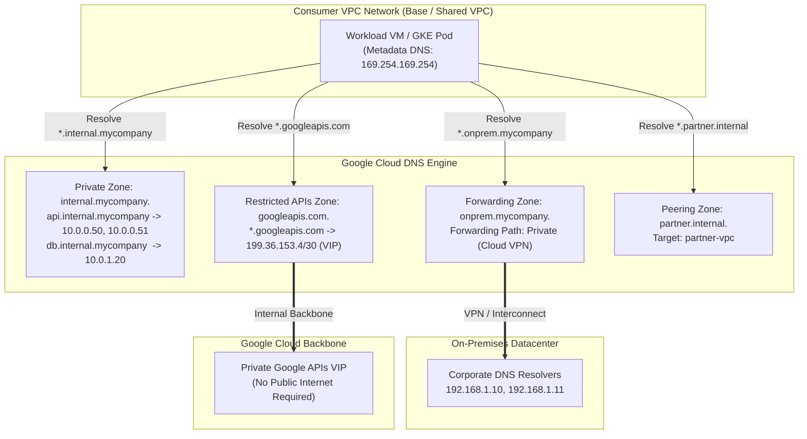

# Google Cloud DNS Custom Module

[](https://www.terraform.io/)
[](https://cloud.google.com/)
[](#declarative-yaml-schema)
[](#architecture-overview)

This module implements a production-grade, declarative **Google Cloud DNS** solution driven by human-readable YAML configurations. It provides turnkey support for enterprise domain name resolution patterns across Google Cloud Platform (GCP):

1. **Private Authoritative Zones:** Internal name resolution and service discovery for workloads within VPC networks.
2. **Hybrid DNS Forwarding:** Forwarding queries for on-premises domains (`*.corp`, `*.internal`) across Cloud VPN or Cloud Interconnect to corporate DNS resolvers.
3. **Cross-VPC DNS Peering:** Sharing internal DNS namespaces across disparate VPC networks.
4. **Restricted Google APIs Routing:** Enforcing zero-egress security by resolving `*.googleapis.com` to the private VIP (`199.36.153.4/30`) for VPC Service Controls compliance.

---

## Table of Contents

- [Architecture Overview](#architecture-overview)
- [Module Design & File Structure](#module-design--file-structure)
- [Prerequisites & IAM Permissions](#prerequisites--iam-permissions)
- [Declarative YAML Schema](#declarative-yaml-schema)
  - [1. Private Authoritative Zone](#1-private-authoritative-zone)
  - [2. Hybrid On-Premises Forwarding Zone](#2-hybrid-on-premises-forwarding-zone)
  - [3. Restricted Google APIs Zone](#3-restricted-google-apis-zone)
  - [4. Cross-VPC DNS Peering Zone](#4-cross-vpc-dns-peering-zone)
- [Usage Example](#usage-example)
- [Module Inputs](#module-inputs)
- [Module Outputs](#module-outputs)
- [Resilience & Engineering Highlights](#resilience--engineering-highlights)

---

## Architecture Overview

The diagram below illustrates how Cloud DNS routes queries within an enterprise VPC, seamlessly handling internal microservices, on-premises hybrid forwarding, and private Google APIs:



---

## Module Design & File Structure

This module follows a clean, single-responsibility architecture:

```
networking-infrastructure/cloud-dns/
├── 0-locals.tf           # YAML decoding, FQDN normalization, multi-tier network binding resolution
├── 1-managed-zones.tf    # Dynamic google_dns_managed_zone (private, forwarding, peering)
├── 2-dns-records.tf      # Dynamic google_dns_record_set with automatic FQDN resolution
├── variables.tf          # Module inputs: yaml_config_path, project_id, network_self_link(s)
├── outputs.tf            # Managed zone IDs, nameservers, record metrics, and summaries
├── versions.tf           # Terraform and Google provider constraints
└── README.md             # Comprehensive architecture and technical documentation
```

### Resource Manifest
- [0-locals.tf](file:///d:/GCP-DevOps-WorkSpace/gcp-terraform-custom-modules/networking-infrastructure/cloud-dns/0-locals.tf): Resolves target project ID, normalizes trailing dots (`.`), computes multi-tier network attachments, and flattens DNS records into deterministic state keys.
- [1-managed-zones.tf](file:///d:/GCP-DevOps-WorkSpace/gcp-terraform-custom-modules/networking-infrastructure/cloud-dns/1-managed-zones.tf): Provisions `google_dns_managed_zone` resources with dynamic `private_visibility_config`, `forwarding_config`, and `peering_config`.
- [2-dns-records.tf](file:///d:/GCP-DevOps-WorkSpace/gcp-terraform-custom-modules/networking-infrastructure/cloud-dns/2-dns-records.tf): Provisions `google_dns_record_set` resources with explicit dependency on zone creation.

---

## Prerequisites & IAM Permissions

To manage Cloud DNS managed zones and record sets, the Terraform service account or caller identity requires the following IAM role on the target project:

| IAM Role | GCP Permission Identifier | Purpose |
| :--- | :--- | :--- |
| **DNS Administrator** | `roles/dns.admin` | Full control over Google Cloud DNS managed zones and record sets. |
| **Compute Network Viewer** | `roles/compute.networkViewer` | Read VPC network self-links for private visibility association. |

Enable the required API on your target project:
```bash
gcloud services enable dns.googleapis.com compute.googleapis.com --project=YOUR_PROJECT_ID
```

---

## Declarative YAML Schema

All zones and records are managed through a structured YAML file.

### Schema Attributes

| Field | Type | Required | Description |
| :--- | :--- | :--- | :--- |
| `project_id` | `string` | Optional | Target GCP Project ID (overrides or supplements `var.project_id`). |
| `networks` | `list(string)` | Optional | Global list of VPC network URLs or self-links to bind to private zones. |
| `network_self_link` | `string` | Optional | Global single VPC network self-link to bind to private zones. |
| `zones` | `list(object)` | **Yes** | List of managed DNS zone specifications. |

### Zone Object Attributes

| Zone Field | Type | Required | Description |
| :--- | :--- | :--- | :--- |
| `name` | `string` | **Yes** | Unique identifier for the managed zone (alphanumeric and dashes). |
| `dns_name` | `string` | **Yes** | DNS domain suffix (e.g. `internal.mycompany.` — trailing dot auto-appended if omitted). |
| `description` | `string` | No | Description of the zone purpose. |
| `type` | `string` | No | Zone type: `"private"`, `"forwarding"`, or `"peering"`. Defaults to `"private"`. |
| `networks` | `list(string)` | No | Specific VPC network URLs to bind to this zone (overrides global). |
| `forwarding_path` | `string` | No | For forwarding zones: `"default"` (public internet) or `"private"` (Cloud VPN/Interconnect). |
| `target_name_servers` | `list(string)` | Cond. | Target IP addresses of upstream DNS resolvers (required for forwarding zones). |
| `peer_network_url` | `string` | Cond. | Self-link of target VPC network for peering zones (required for peering zones). |
| `records` | `list(object)` | No | List of resource record sets belonging to this zone. |

### Record Object Attributes

| Record Field | Type | Required | Description |
| :--- | :--- | :--- | :--- |
| `name` | `string` | **Yes** | Record name. Use `"@"` or `""` for apex domain, subdomain label (`"api"`), or full FQDN (`"api.domain.com."`). |
| `type` | `string` | **Yes** | DNS record type: `A`, `AAAA`, `CNAME`, `TXT`, `MX`, `PTR`, `SRV`, etc. |
| `ttl` | `number` | No | Time-to-live in seconds (defaults to `300`). |
| `rrdatas` | `list(string)` | **Yes** | List of resource record values (IP addresses, canonical names, strings). |

---

### YAML Patterns

#### 1. Private Authoritative Zone
```yaml
zones:
  - name: "internal-corp"
    dns_name: "internal.mycompany."
    description: "Private internal zone for microservices discovery"
    type: "private"
    records:
      - name: "api"
        type: "A"
        ttl: 300
        rrdatas: ["10.0.0.50", "10.0.0.51"]
      - name: "web"
        type: "CNAME"
        ttl: 300
        rrdatas: ["api.internal.mycompany."]
```

#### 2. Hybrid On-Premises Forwarding Zone
```yaml
zones:
  - name: "onprem-forwarding"
    dns_name: "onprem.mycompany."
    description: "Forwarding queries for on-premise resources"
    type: "forwarding"
    forwarding_path: "private"       # Resolves via Cloud VPN / Cloud Interconnect
    target_name_servers:
      - "192.168.1.10"
      - "192.168.1.11"
    records: []
```

#### 3. Restricted Google APIs Zone
Enforces Google API calls to resolve to the restricted VIP range `199.36.153.4/30`, preventing external data exfiltration and ensuring traffic stays on Google's private backbone:
```yaml
zones:
  - name: "googleapis-restricted"
    dns_name: "googleapis.com."
    description: "Private routing for Google APIs"
    type: "private"
    records:
      - name: "restricted"
        type: "A"
        ttl: 300
        rrdatas:
          - "199.36.153.4"
          - "199.36.153.5"
          - "199.36.153.6"
          - "199.36.153.7"
      - name: "*"
        type: "CNAME"
        ttl: 300
        rrdatas: ["restricted.googleapis.com."]
```

#### 4. Cross-VPC DNS Peering Zone
```yaml
zones:
  - name: "partner-peering"
    dns_name: "partner.internal."
    description: "DNS peering to partner VPC"
    type: "peering"
    peer_network_url: "projects/partner-project/global/networks/partner-vpc"
    records: []
```

---

## Usage Example

```hcl
module "cloud_dns" {
  source            = "git::https://github.com/yuva-cloud-devops/gcp-terraform-custom-modules.git//networking-infrastructure/cloud-dns?ref=main"
  yaml_config_path  = "${path.module}/dns.yaml"
  network_self_link = module.vpc.network_self_link
}
```

---

## Module Inputs

| Name | Type | Default | Required | Description |
| :--- | :--- | :--- | :---: | :--- |
| `yaml_config_path` | `string` | `"./dns.yaml"` | No | Filesystem path to the YAML file defining Cloud DNS zones and records. |
| `project_id` | `string` | `null` | No | GCP Project ID where Cloud DNS zones are created (can also be defined in YAML). |
| `network_self_link` | `string` | `null` | No | Single VPC network self_link or URL to bind private DNS zones to. |
| `network_self_links` | `list(string)` | `[]` | No | List of VPC network self_links or URLs to bind private DNS zones to. |

---

## Module Outputs

| Name | Type | Description |
| :--- | :--- | :--- |
| `managed_zones` | `map(object)` | Map of created managed zone names to their full resource attributes. |
| `zone_ids` | `map(string)` | Map of created managed zone names to their resource IDs. |
| `zone_dns_names` | `map(string)` | Map of managed zone names to their fully qualified domain names (`dns_name`). |
| `name_servers` | `map(list(string))` | Map of managed zone names to their assigned Cloud DNS name servers. |
| `records` | `map(object)` | Map of created DNS record sets keyed by `zone/type/name`. |
| `total_zones_count` | `number` | Total number of Cloud DNS managed zones provisioned. |
| `total_records_count` | `number` | Total number of Cloud DNS record sets provisioned. |

---

## Resilience & Engineering Highlights

1. **Automatic FQDN Normalization:**
   DNS standards mandate trailing dots for fully qualified domain names (`example.com.`). The module automatically appends trailing dots to zone domains if omitted and resolves relative record names (e.g., `"api"` becomes `"api.internal.mycompany."`), while apex entries (`"@"`, `""`) resolve to the zone root.
2. **Multi-Tier Network Resolution:**
   VPC network bindings can be supplied via module variables (`var.network_self_link`, `var.network_self_links`), globally in YAML (`network_self_link`, `networks`), or per-zone in YAML, providing maximum composition flexibility across single-VPC and Shared VPC environments.
3. **Deterministic State Keys:**
   Record sets are keyed as `${zone_name}/${type}/${name}`, safely substituting wildcards (`*` $\rightarrow$ `wildcard`) to avoid HCL state address parsing issues.
4. **Ordering & Safety:**
   Record set creation enforces `depends_on = [google_dns_managed_zone.zones]` to guarantee zones exist before record sets are registered.

