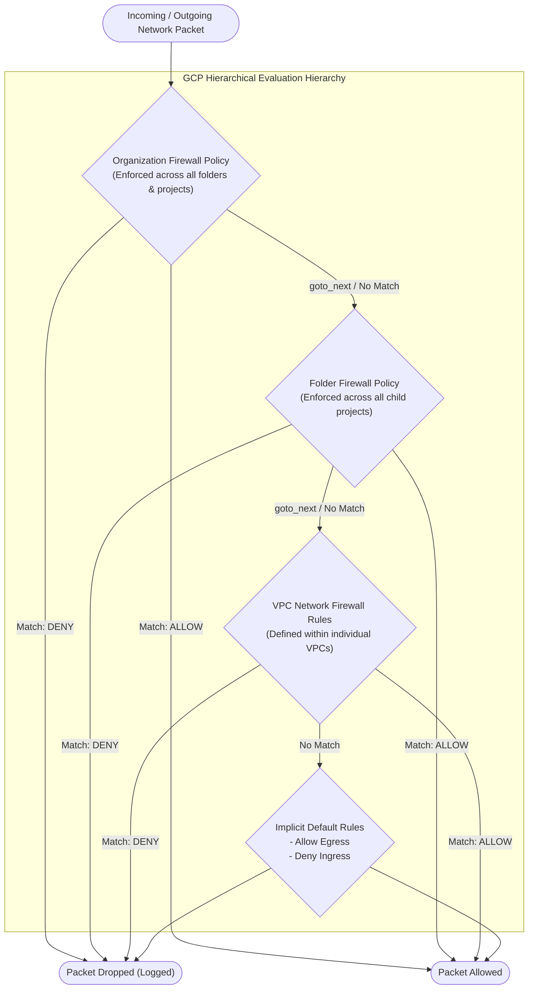

# Hierarchical Firewall Policies Module

[](https://www.terraform.io/)
[](https://cloud.google.com/)
[](#declarative-yaml-schema)
[](#architecture--evaluation-hierarchy)

This module implements enterprise **GCP Hierarchical Firewall Policies**, enabling central security and infrastructure teams to enforce mandatory, non-negotiable security guardrails at the **Organization** or **Folder** level across all nested VPC networks.

Hierarchical Firewall rules are evaluated **before** any VPC-level or Network Firewall rules, allowing SecOps teams to unilaterally block insecure ingress/egress vectors (such as public SSH, RDP, or unencrypted database ports) and mandate compliance regardless of project-level configurations.

---

## Table of Contents

- [Architecture & Evaluation Hierarchy](#architecture--evaluation-hierarchy)
- [Module Design & File Structure](#module-design--file-structure)
- [Prerequisites & IAM Permissions](#prerequisites--iam-permissions)
- [Declarative YAML Schema](#declarative-yaml-schema)
- [Usage Example](#usage-example)
- [Module Inputs](#module-inputs)
- [Module Outputs](#module-outputs)
- [Security Best Practices](#security-best-practices)

---

## Architecture & Evaluation Hierarchy

Google Cloud evaluates firewall rules from the top of the resource hierarchy down to individual virtual machines. Hierarchical policies take absolute precedence over VPC-level firewall rules:



---

## Module Design & File Structure

This module is split into focused, single-responsibility Terraform files:

```
networking-infrastructure/hierarchical-firewalls/
├── 0-locals.tf                # Decodes YAML and prepares deterministic priority mapping
├── 1-firewall.tf              # Provisions the google_compute_firewall_policy container
├── 2-rules.tf                 # Dynamically generates directional rules and Layer 4 port blocks
├── 3-firewall-association.tf  # Binds the policy to the target Folder or Organization node
├── variables.tf               # Input parameter: yaml_config_path
├── outputs.tf                 # Exports policy IDs, attachment targets, and rule summaries
├── versions.tf                # Pins Terraform and Google provider constraints
└── README.md                  # Comprehensive architectural and reference documentation
```

### Resource Manifest
- [0-locals.tf](file:///d:/GCP-DevOps-WorkSpace/gcp-terraform-custom-modules/networking-infrastructure/hierarchical-firewalls/0-locals.tf): Resolves `parent_target` (`organizations/{id}` or `folders/{id}`) and indexes rules deterministically by priority.
- [1-firewall.tf](file:///d:/GCP-DevOps-WorkSpace/gcp-terraform-custom-modules/networking-infrastructure/hierarchical-firewalls/1-firewall.tf): Provisions `google_compute_firewall_policy`.
- [2-rules.tf](file:///d:/GCP-DevOps-WorkSpace/gcp-terraform-custom-modules/networking-infrastructure/hierarchical-firewalls/2-rules.tf): Constructs `google_compute_firewall_policy_rule` resources with dynamic Layer 4 matching.
- [3-firewall-association.tf](file:///d:/GCP-DevOps-WorkSpace/gcp-terraform-custom-modules/networking-infrastructure/hierarchical-firewalls/3-firewall-association.tf): Associates the policy with the target node, with explicit `depends_on = [google_compute_firewall_policy_rule.rules]`.

---

## Prerequisites & IAM Permissions

Applying hierarchical firewall policies requires organizational or folder-level administrative access. The Terraform deploying identity must possess one of the following IAM roles:

| IAM Role | Resource Level | Required Permissions |
| :--- | :--- | :--- |
| **Hierarchical Firewall Policy Admin** (`roles/compute.orgFirewallPolicyAdmin`) | Organization or Folder | `compute.firewallPolicies.create`<br/>`compute.firewallPolicies.update`<br/>`compute.firewallPolicies.setIamPolicy` |
| **Organization Security Policy Admin** (`roles/compute.orgSecurityPolicyAdmin`) | Organization or Folder | Full management over organizational security policies and rules. |
| **Organization Administrator** (`roles/resourcemanager.organizationAdmin`) | Organization | Allows delegating organizational policies and node associations. |

---

## Declarative YAML Schema

All policies, guardrail rules, and attachment nodes are declared in a YAML configuration file.

### Schema Attributes

| Field | Type | Required | Description |
| :--- | :--- | :--- | :--- |
| `parent_type` | `string` | **Yes** | Attachment target type. Must be either `"organization"` or `"folder"`. |
| `parent_id` | `string` | **Yes** | The numerical ID of the target Organization or Folder (e.g. `"123456789012"`). |
| `policy_name` | `string` | **Yes** | Short name for the hierarchical firewall policy (max 63 lowercase alphanumeric chars). |
| `description` | `string` | No | Human-readable explanation of policy intent and ownership. |
| `rules` | `list(object)` | **Yes** | Ordered list of security rules to configure in the policy. |

### Rule Object Attributes

| Rule Field | Type | Required | Description |
| :--- | :--- | :--- | :--- |
| `priority` | `number` | **Yes** | Unique integer (0 to 2147483646). Lower values have higher precedence. |
| `direction` | `string` | **Yes** | Either `"INGRESS"` or `"EGRESS"`. |
| `action` | `string` | **Yes** | Action when matched: `"allow"`, `"deny"`, or `"goto_next"`. |
| `description` | `string` | No | Description explaining rule rationale. |
| `enable_logging` | `bool` | No | Whether to stream rule match events to Cloud Logging (defaults to `false`). |
| `source_ranges` | `list(string)` | Cond. | CIDR blocks for INGRESS evaluation (required when direction is INGRESS). |
| `destination_ranges` | `list(string)` | Cond. | CIDR blocks for EGRESS evaluation (required when direction is EGRESS). |
| `layer4_configs` | `list(object)` | **Yes** | Protocols and ports: `ip_protocol` (`"tcp"`, `"udp"`, `"icmp"`, `"all"`) and optional `ports` list. |

### Example YAML Specification
```yaml
parent_type: "folder"
parent_id: "123456789012"

policy_name: "secops-mandatory-guardrails"
description: "Non-negotiable organization-wide firewall guardrails"

rules:
  # 1. Deny public SSH from entire internet
  - priority: 1000
    direction: "INGRESS"
    action: "deny"
    description: "Block public SSH from 0.0.0.0/0"
    enable_logging: true
    source_ranges:
      - "0.0.0.0/0"
    layer4_configs:
      - ip_protocol: "tcp"
        ports: ["22"]

  # 2. Deny public RDP from entire internet
  - priority: 1001
    direction: "INGRESS"
    action: "deny"
    description: "Block public RDP from 0.0.0.0/0"
    enable_logging: true
    source_ranges:
      - "0.0.0.0/0"
    layer4_configs:
      - ip_protocol: "tcp"
        ports: ["3389"]

  # 3. Allow Google Health Checks
  - priority: 2000
    direction: "INGRESS"
    action: "allow"
    description: "Allow Google Cloud Load Balancer and Health Check probes"
    enable_logging: false
    source_ranges:
      - "35.191.0.0/16"
      - "130.211.0.0/22"
    layer4_configs:
      - ip_protocol: "tcp"

  # 4. Allow RFC 1918 Private Traffic
  - priority: 3000
    direction: "INGRESS"
    action: "allow"
    description: "Allow all internal RFC1918 traffic between VPC subnets"
    enable_logging: false
    source_ranges:
      - "10.0.0.0/8"
      - "172.16.0.0/12"
      - "192.168.0.0/16"
    layer4_configs:
      - ip_protocol: "all"
```

---

## Usage Example

```hcl
module "hierarchical_firewalls" {
  source           = "git::https://github.com/your-org/gcp-terraform-custom-modules.git//networking-infrastructure/hierarchical-firewalls"
  yaml_config_path = "${path.module}/firewalls.yaml"
}
```

---

## Module Inputs

| Name | Type | Default | Required | Description |
| :--- | :--- | :--- | :---: | :--- |
| `yaml_config_path` | `string` | `"./firewalls.yaml"` | No | Absolute or relative filesystem path to the YAML firewall policy configuration file. |

---

## Module Outputs

| Name | Type | Description |
| :--- | :--- | :--- |
| `policy_id` | `string` | Resource identifier of the provisioned hierarchical firewall policy container. |
| `policy_name` | `string` | Short name of the hierarchical firewall policy. |
| `attached_target` | `string` | Fully qualified target Folder or Organization URI where policy is attached. |
| `association_id` | `string` | Resource identifier of the policy association. |
| `configured_rule_priorities` | `list(number)` | List of configured rule priorities in ascending order. |
| `rules_summary` | `map(object)` | Map of generated rules containing direction, action, description, and logging settings. |

---

## Security Best Practices

1. **Explicit Priority Staggering:**
   Stagger priorities in increments of 100 or 1,000 (e.g., `1000`, `2000`, `3000`) to allow room for inserting high-priority emergency or bypass rules without needing re-indexing.
2. **Enable Audit Logging on Denials:**
   Always set `enable_logging: true` on broad perimeter denial rules (such as 0.0.0.0/0 SSH/RDP blocks). Log streams provide threat telemetry and aid in discovering rogue ingress attempts.
3. **Use `goto_next` for Delegation:**
   If a folder policy permits certain traffic conditionally, use `action: "goto_next"` to delegate further granular decisions down to child folders or project-level VPC firewall rules.
4. **Pre-flight Rules Dependency:**
   The association resource maintains an explicit `depends_on = [google_compute_firewall_policy_rule.rules]` to guarantee no un-configured or blank policies are attached to active production workloads.

