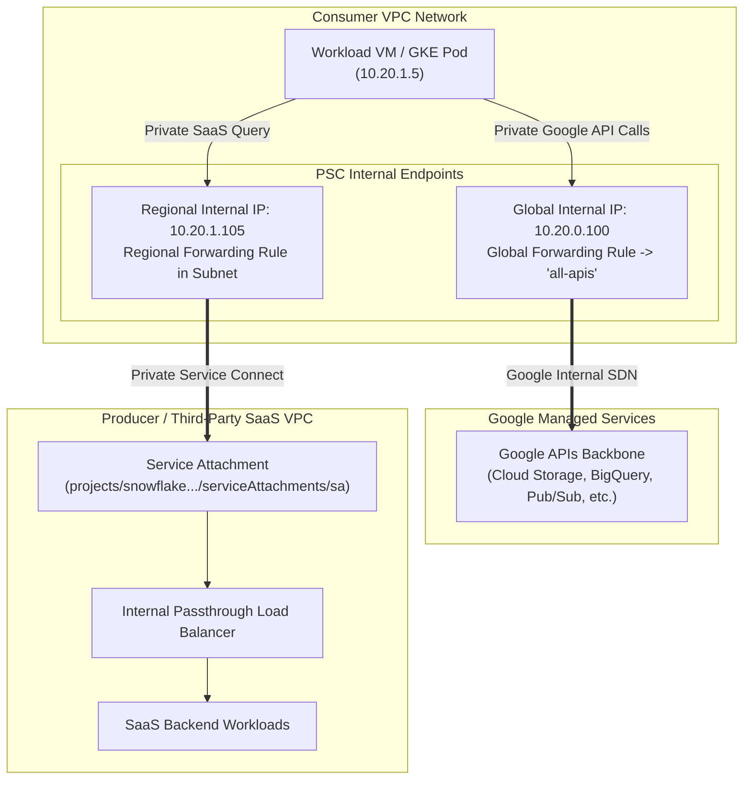

# Google Cloud Private Service Connect (PSC) Custom Module

[](https://www.terraform.io/)
[](https://cloud.google.com/)
[](#declarative-yaml-schema)
[](#architecture-overview)

This module provides a production-grade, declarative Terraform implementation for **Google Cloud Private Service Connect (PSC)** driven by structured YAML configurations.

Private Service Connect allows private consumption of services across VPC networks and Google-managed services using internal IP addresses within your consumer VPC, eliminating the need for VPC Peering, IP address overlap negotiations, NAT configurations, or external public IPs.

---

## Table of Contents

- [Architecture Overview](#architecture-overview)
- [Module Design & Supported Flavors](#module-design--supported-flavors)
  - [Flavor 1: PSC for Google APIs (Global)](#flavor-1-psc-for-google-apis-global)
  - [Flavor 2: PSC for Published Services / SaaS (Regional)](#flavor-2-psc-for-published-services--saas-regional)
- [Directory Structure](#directory-structure)
- [Prerequisites & IAM Permissions](#prerequisites--iam-permissions)
- [Declarative YAML Schema](#declarative-yaml-schema)
- [Usage Example](#usage-example)
- [Module Inputs](#module-inputs)
- [Module Outputs](#module-outputs)
- [Resilience & Engineering Highlights](#resilience--engineering-highlights)

---

## Architecture Overview

Private Service Connect provides two primary consumption models:



---

## Module Design & Supported Flavors

### Flavor 1: PSC for Google APIs (Global)
- **Target:** Connects consumer workloads to Google Cloud APIs (`all-apis` or `vpc-sc`).
- **Mechanism:** Reserves an internal IP address (`google_compute_global_address` with purpose `PRIVATE_SERVICE_CONNECT`) and attaches a global forwarding rule (`google_compute_global_forwarding_rule`).
- **Benefit:** Workloads in private subnets communicate with Google APIs without NAT gateways or external internet routability.

### Flavor 2: PSC for Published Services / SaaS (Regional)
- **Target:** Connects directly to third-party SaaS providers (e.g. Snowflake, Databricks, MongoDB Atlas) or internal microservices published across different VPC networks or projects.
- **Mechanism:** Reserves an internal regional IP address (`google_compute_address`) within a consumer subnet and creates a regional forwarding rule (`google_compute_forwarding_rule`) pointing to the producer's `target_service_attachment`.
- **Benefit:** No CIDR coordination or VPC peering limits required.

---

## Directory Structure

```
networking-infrastructure/private-service-connect/
├── 0-locals.tf           # Decodes YAML, normalizes subnetwork URIs & IP allocations
├── 1-psc-apis.tf         # Flavor 1: Global IP & Forwarding Rule for Google APIs
├── 2-psc-services.tf     # Flavor 2: Regional IP & Forwarding Rule for Service Attachments
├── variables.tf          # Module inputs (yaml_config_path, project_id, network_self_link)
├── outputs.tf            # Comprehensive endpoint maps, IPs, and self-links
├── versions.tf           # Terraform and Google provider constraints
└── README.md             # Architecture and module documentation
```

---

## Prerequisites & IAM Permissions

To manage Private Service Connect endpoints, the deploying identity or automation runner requires the following IAM permissions:

| IAM Role | GCP Permission Identifiers | Purpose |
| :--- | :--- | :--- |
| **Compute Network Admin** | `roles/compute.networkAdmin` | Reserve internal IP addresses and create global/regional forwarding rules. |
| **Service Usage Admin** | `roles/serviceusage.serviceUsageAdmin` | Ensure `compute.googleapis.com` is enabled on the project. |

---

## Declarative YAML Schema

All endpoints, targets, and IP configurations are specified in a YAML configuration file.

### Root Schema Attributes

| Field | Type | Required | Description |
| :--- | :--- | :--- | :--- |
| `project_id` | `string` | Optional | Target GCP Project ID (overrides or supplements `var.project_id`). |
| `network_self_link` | `string` | Optional | Self-link or URL of the consumer VPC network (overrides or supplements `var.network_self_link`). |
| `google_apis_endpoints` | `list(object)` | Optional | List of global Google APIs PSC endpoint specifications. |
| `service_attachment_endpoints` | `list(object)` | Optional | List of regional published service / SaaS endpoint specifications. |

### `google_apis_endpoints` Schema

| Field | Type | Required | Description |
| :--- | :--- | :--- | :--- |
| `name` | `string` | **Yes** | Unique name for the PSC endpoint and reserved IP. |
| `ip_address` | `string` | **Yes** | Internal IP address to assign (e.g. `"10.20.0.100"`). |
| `target` | `string` | No | Bundle target: `"all-apis"` (default) or `"vpc-sc"` (for strict perimeters). |
| `description` | `string` | No | Human-readable description of the endpoint. |

### `service_attachment_endpoints` Schema

| Field | Type | Required | Description |
| :--- | :--- | :--- | :--- |
| `name` | `string` | **Yes** | Unique name for the PSC endpoint and forwarding rule. |
| `region` | `string` | **Yes** | GCP Region where the consumer endpoint is deployed (e.g. `"asia-south1"`). |
| `subnet_name` | `string` | **Yes** | Subnet short name or full subnetwork URI where endpoint IP resides. |
| `target_service_attachment` | `string` | **Yes** | Full resource URI of the producer's Service Attachment. |
| `ip_address` | `string` | No | Static internal IP address, or `null` for automatic allocation from the subnet. |
| `description` | `string` | No | Human-readable description of the SaaS connection. |

### Example YAML Specification
```yaml
project_id: "my-consumer-project"

# 1. Global PSC Endpoint for Google APIs
google_apis_endpoints:
  - name: "psc-google-apis"
    ip_address: "10.20.0.100"
    target: "all-apis"
    description: "Private endpoint for Google Cloud APIs"

# 2. Regional PSC Endpoints for SaaS / Producer Services
service_attachment_endpoints:
  - name: "psc-snowflake-prod"
    region: "asia-south1"
    subnet_name: "private-subnet-mumbai"
    target_service_attachment: "projects/snowflake-prod-host/regions/asia-south1/serviceAttachments/snowflake-sa"
    ip_address: "10.20.1.105"
    description: "Private connection to Snowflake warehouse"

  - name: "psc-mongodb-atlas"
    region: "asia-south1"
    subnet_name: "private-subnet-mumbai"
    target_service_attachment: "projects/mongodb-atlas-host/regions/asia-south1/serviceAttachments/atlas-sa"
    ip_address: null # Auto-allocates an available IP from the subnet
    description: "Private connection to MongoDB Atlas"
```

---

## Usage Example

```hcl
module "psc" {
  source            = "git::https://github.com/yuva-cloud-devops/gcp-terraform-custom-modules.git//networking-infrastructure/private-service-connect?ref=main"
  yaml_config_path  = "${path.module}/psc.yaml"
  network_self_link = module.networking.vpcs["platform-foundation-vpc"].self_link
}
```

---

## Module Inputs

| Name | Type | Default | Required | Description |
| :--- | :--- | :--- | :---: | :--- |
| `yaml_config_path` | `string` | `"./psc.yaml"` | No | Filesystem path to the YAML file defining PSC endpoints and service targets. |
| `project_id` | `string` | `null` | No | GCP Project ID where PSC endpoints are created (can also be specified in YAML). |
| `network_self_link` | `string` | `null` | No | Self-link or URL of the consumer VPC network (can also be specified in YAML). |

---

## Module Outputs

| Name | Type | Description |
| :--- | :--- | :--- |
| `google_apis_endpoints` | `map(object)` | Map of Google APIs endpoints with name, target, IP address, and forwarding rule IDs. |
| `service_attachment_endpoints` | `map(object)` | Map of SaaS Service Attachment endpoints with region, IP, and target attachment URIs. |
| `google_apis_ips` | `map(string)` | Map of Google APIs endpoint names to their reserved internal IP addresses. |
| `service_attachment_ips` | `map(string)` | Map of SaaS endpoint names to their reserved regional internal IP addresses. |
| `total_google_apis_endpoints` | `number` | Total number of Google APIs PSC endpoints created. |
| `total_service_attachment_endpoints` | `number` | Total number of SaaS Service Attachment PSC endpoints created. |

---

## Resilience & Engineering Highlights

1. **Subnetwork URI Normalization:**
   Supports passing either a short subnet name (e.g. `"my-subnet"`) or a fully qualified self-link (e.g. `"projects/.../subnetworks/..."`). Short names are automatically expanded with the resolved project and region.
2. **Dynamic IP Allocation Support:**
   Supports both explicit static IP reservations (useful for fixed DNS configurations) and automatic IP allocation from the target subnet (`ip_address: null`).
3. **Explicit Forwarding Rule Dependencies:**
   Forwarding rules maintain explicit `depends_on` blocks referencing address reservations, preventing Google Cloud API race conditions during creation.
4. **PSC Protocol Constraints:**
   Google Cloud requires `load_balancing_scheme = ""` (an empty string) for Private Service Connect forwarding rules. The module handles this automatically.

