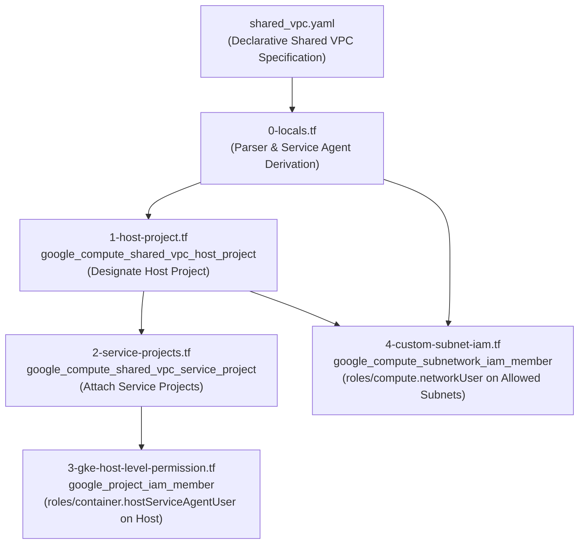
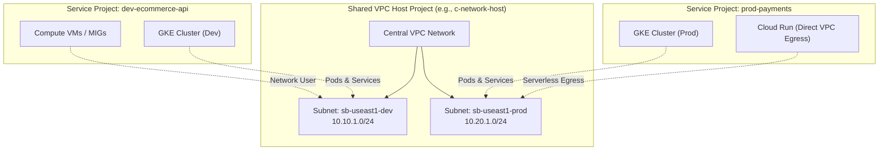

# GCP Shared VPC (Cross-Project Networking & Subnet IAM) Module

[](https://www.terraform.io/)
[](https://registry.terraform.io/providers/hashicorp/google/latest)
[](LICENSE)

An enterprise-grade, YAML-driven Terraform module for Google Cloud Platform (GCP) to orchestrate **Shared VPC (Cross-Project Networking)**. This module enables centralized network management by designating a Host Project, attaching Service Projects, automating Google service agent permissions (GKE, Google APIs, Cloud Run), and provisioning fine-grained, least-privilege subnetwork IAM delegations.

---

## Architecture Overview



### Shared VPC Cross-Project Topology



---

## Why Use This Module?

In Google Cloud, Shared VPC allows an organization to connect resources from multiple service projects to a common Virtual Private Cloud (VPC) network hosted in a centralized project. 

However, managing Shared VPC manually introduces significant operational complexity:
1. **Host-Level Enablement**: The host project must be enabled and service projects attached in strict dependency order.
2. **Hidden Google Service Agents**: Workloads like Compute Engine, GKE, and Cloud Run rely on specialized Google internal service agents (`<PROJECT_NUMBER>@cloudservices.gserviceaccount.com`, `service-<PROJECT_NUMBER>@container-engine-robot...`, `service-<PROJECT_NUMBER>@serverless-robot-prod...`) that each require explicit `roles/compute.networkUser` permissions on host subnets.
3. **GKE Cross-Project Requirements**: GKE clusters in service projects fail to provision unless their service agent has `roles/container.hostServiceAgentUser` at the **host project level** to manage firewall rules and routes.
4. **Least-Privilege Subnet Scoping**: Granting `networkUser` at the project level is dangerous because service projects gain access to *all* subnets in the host VPC. This module strictly scopes permissions to **individual allowed subnetworks**.

This module automates this entire pipeline through a single, declarative YAML configuration.

---

## Key Features

1. **Declarative Specification (`shared_vpc.yaml`)**:
   - Centralize host project identification, service project attachments, allowed subnets, and IAM assignments in human-readable YAML.
2. **Automated Service Agent Derivation (`0-locals.tf`)**:
   - Automatically derives the required Google service agent emails from the service project's `project_number`:
     - **Google APIs Service Agent**: `<PROJECT_NUMBER>@cloudservices.gserviceaccount.com` (for Compute Engine VMs and Managed Instance Groups).
     - **GKE Service Agent**: `service-<PROJECT_NUMBER>@container-engine-robot.iam.gserviceaccount.com` (when `enable_gke: true`).
     - **Cloud Run / Serverless Robot**: `service-<PROJECT_NUMBER>@serverless-robot-prod.iam.gserviceaccount.com` (when `enable_cloud_run: true`).
3. **Host Project Enablement (`1-host-project.tf`)**:
   - Idempotently designates the centralized networking project as a Shared VPC Host Project via `google_compute_shared_vpc_host_project`.
4. **Dynamic Service Project Attachment (`2-service-projects.tf`)**:
   - Attaches any number of workload service projects via `google_compute_shared_vpc_service_project`.
5. **GKE Host-Level Security Baseline (`3-gke-host-level-permission.tf`)**:
   - Automatically grants `roles/container.hostServiceAgentUser` on the host project to service project GKE robots when GKE is enabled, preventing cluster provisioning errors.
6. **Least-Privilege Subnet Delegation (`4-custom-subnet-iam.tf`)**:
   - Enforces subnet-level isolation: service project service agents, human developers, Google groups, and CI/CD pipelines are only granted `roles/compute.networkUser` on the specific subnets listed under `allowed_subnets`.
7. **Custom User, Group & CI/CD Access (`custom_subnet_iam`)**:
   - Grants subnet-level network user access to application deployment service accounts, developer groups, or SRE teams without granting broader compute permissions in the host project.

---

## File Structure & Module Breakdown

| File | Purpose | Managed Resources |
|---|---|---|
| [`0-locals.tf`](./0-locals.tf) | Parses YAML, constructs project maps, and calculates robot service agent emails and subnet delegations | Local variables & collections |
| [`1-host-project.tf`](./1-host-project.tf) | Designates the host project for Shared VPC | `google_compute_shared_vpc_host_project.host` |
| [`2-service-projects.tf`](./2-service-projects.tf) | Attaches service projects to the Shared VPC host project | `google_compute_shared_vpc_service_project.service_projects` |
| [`3-gke-host-level-permission.tf`](./3-gke-host-level-permission.tf) | Grants GKE service agent host-level permissions (`roles/container.hostServiceAgentUser`) | `google_project_iam_member.gke_host_service_agent` |
| [`4-custom-subnet-iam.tf`](./4-custom-subnet-iam.tf) | Grants `roles/compute.networkUser` on individual subnets to service agents and custom users | `google_compute_subnetwork_iam_member.subnet_network_user` |
| [`variables.tf`](./variables.tf) | Declares module input variables (`yaml_config_path`) | Variable `yaml_config_path` |
| [`outputs.tf`](./outputs.tf) | Exports host project ID, attached service projects, and delegation counts | Outputs `host_project_id`, `attached_service_projects`, etc. |
| [`versions.tf`](./versions.tf) | Specifies minimum Terraform and Google provider versions | Provider `hashicorp/google` |

---

## Requirements

| Name | Version |
|---|---|
| <a name="requirement_terraform"></a> [terraform](#requirement\_terraform) | `>= 1.5.0` |
| <a name="requirement_google"></a> [google](#requirement\_google) | `>= 5.0.0, < 7.0.0` |

---

## Inputs

| Name | Description | Type | Default | Required |
|---|---|---|---|:---:|
| `yaml_config_path` | Path to the Shared VPC YAML configuration file defining host project, service projects, allowed subnets, and subnet IAM bindings. | `string` | `"./shared_vpc.yaml"` | no |

---

## Outputs

| Name | Description | Type |
|---|---|---|
| `host_project_id` | The GCP Project ID configured as the Shared VPC Host Project. | `string` |
| `attached_service_projects` | List of GCP Project IDs successfully attached as Shared VPC Service Projects. | `list(string)` |
| `configured_subnet_delegations` | Total number of `roles/compute.networkUser` IAM delegations provisioned across all subnets. | `number` |
| `service_project_attachments` | Map of service project IDs to their `google_compute_shared_vpc_service_project` resource details. | `map(object)` |

---

## YAML Configuration Reference (`shared_vpc.yaml`)

```yaml
# ==============================================================================
# Shared VPC Configuration Specification
# ==============================================================================

# The centralized networking project acting as the Shared VPC Host
host_project_id: "c-network-host"

# ------------------------------------------------------------------------------
# 1. Service Projects to Attach
# ------------------------------------------------------------------------------
service_projects:
  - project_id: "dev-ecommerce-api"               # GCP project ID of the service project
    project_number: "102938475610"                # Numeric project number (used for service agent derivation)
    enable_gke: true                              # Auto-provisions GKE hostServiceAgentUser + Subnet IAM
    enable_cloud_run: false                       # Auto-provisions Cloud Run / Serverless robot Subnet IAM
    allowed_subnets:                              # Subnets in host VPC this service project can access
      - name: "sb-useast1-dev"
        region: "us-east1"

  - project_id: "prod-payments"
    project_number: "987654321098"
    enable_gke: true
    enable_cloud_run: true
    allowed_subnets:
      - name: "sb-useast1-prod"
        region: "us-east1"

# ------------------------------------------------------------------------------
# 2. Custom User / Group / CI-CD Subnet Access
# ------------------------------------------------------------------------------
# Grants 'roles/compute.networkUser' on designated subnets to developers,
# operations teams, or deployment service accounts.
custom_subnet_iam:
  - subnet_name: "sb-useast1-dev"
    region: "us-east1"
    members:
      - "group:ecommerce-devs@mycompany.com"
      - "serviceAccount:cicd-deployer-sa@dev-ecommerce-api.iam.gserviceaccount.com"

  - subnet_name: "sb-useast1-prod"
    region: "us-east1"
    members:
      - "group:sre-team@mycompany.com"
```

---

## Usage Guide

### 1. Typical Architecture: Base VPC + Shared VPC

In enterprise landing zones, the VPC network and subnets are provisioned first (e.g., via the [`vpc-subnet-router-nat-firewall`](../vpc-subnet-router-nat-firewall/) module), and this `shared-vpc` module is layered on top to attach workload projects and delegate subnets.

```hcl
# 1. Base VPC and Subnetworks in the Host Project
module "base_network" {
  source           = "git::https://github.com/yuva-cloud-devops/gcp-terraform-custom-modules.git//networking-infrastructure/vpc-subnet-router-nat-firewall?ref=main"
  config_file_path = "${path.module}/network-config.yaml"
}

# 2. Shared VPC Attachments & Subnet Delegations
module "shared_vpc" {
  source           = "git::https://github.com/yuva-cloud-devops/gcp-terraform-custom-modules.git//networking-infrastructure/shared-vpc?ref=main"
  yaml_config_path = "${path.module}/shared_vpc.yaml"

  # Ensures subnets exist in GCP before applying subnet-level IAM
  depends_on = [module.base_network]
}
```

### 2. Output Inspection (`outputs.tf`)

```hcl
output "shared_vpc_host" {
  value = module.shared_vpc.host_project_id
}

output "attached_service_projects" {
  value = module.shared_vpc.attached_service_projects
}

output "total_subnet_delegations" {
  value = module.shared_vpc.configured_subnet_delegations
}
```

---

## Security & Operational Best Practices

- **Separation of Duties (NetOps vs. AppOps)**:
  - **Network Administrators (NetOps)** maintain complete control over IP spaces, routing, firewall rules, and NAT gateways in the host project.
  - **Application Teams (DevOps/Developers)** deploy workloads (VMs, GKE clusters, Cloud Run) into their own isolated service projects without permissions to modify the underlying network topology.
- **Least-Privilege Subnet IAM**:
  - Never assign `roles/compute.networkUser` at the host project level unless every service project is trusted to deploy into every subnet.
  - This module uses `google_compute_subnetwork_iam_member` to enforce strict subnet boundaries (e.g. `dev-ecommerce-api` cannot attach to `sb-useast1-prod`).
- **Resilient GKE Enablement**:
  - GKE requires `roles/container.hostServiceAgentUser` at the host project level to automatically create internal load balancer forwarding rules and manage cluster firewall rules. This module handles this prerequisite automatically when `enable_gke: true`.
- **Non-Authoritative Member Bindings**:
  - Uses `google_compute_subnetwork_iam_member` instead of authoritative `_binding` or `_policy` resources, guaranteeing that adding new service projects or teams will not accidentally wipe out existing subnet permissions.

---

## License

This module is released under the [MIT License](LICENSE).

