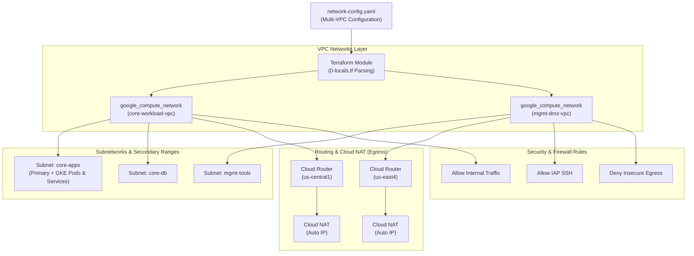

# GCP Multi-VPC, Subnetworks, Cloud Router, Cloud NAT & Firewall Terraform Module

A production-grade, declarative Terraform module for Google Cloud Platform (GCP) that provisions multi-VPC network architectures completely driven by a structured YAML configuration file.

This module automates the end-to-end lifecycle of:
- **VPC Networks** (Custom subnet mode, Global/Regional routing, default route management)
- **Subnetworks** (Primary IP CIDR ranges, Private Google Access, and Secondary IP ranges for GKE Pods & Services)
- **Cloud Routers** (Dedicated or shared per VPC and region)
- **Cloud NAT Gateways** (Auto-allocated egress IPs and configurable logging)
- **Firewall Rules** (Dynamic `INGRESS` and `EGRESS` rules with granular `allow` and `deny` rules)

---

## Architecture Overview



---

## Requirements

| Name | Version |
|------|---------|
| <a name="requirement_terraform"></a> [terraform](#requirement\_terraform) | `>= 1.5.0` |
| <a name="requirement_google"></a> [google](#requirement\_google) | `>= 5.0.0, < 7.0.0` |

---

## Inputs

| Name | Description | Type | Default | Required |
|------|-------------|------|---------|:--------:|
| <a name="input_config_file_path"></a> [config\_file\_path](#input\_config\_file\_path) | Absolute or relative path to the multi-network YAML configuration file. | `string` | n/a | yes |

---

## Outputs

| Name | Description | Downstream Use Cases |
|------|-------------|----------------------|
| <a name="output_vpcs"></a> [vpcs](#output\_vpcs) | Map of created VPCs with `id`, `name`, `self_link`, `gateway_ipv4`, `routing_mode`, and `delete_default_routes_on_create`. | Full VPC metadata inspection |
| <a name="output_vpc_ids"></a> [vpc\_ids](#output\_vpc\_ids) | Map of `{ "<vpc_name>" = "<vpc_id>" }`. | Peering, Shared VPC attachments, interconnects |
| <a name="output_vpc_self_links"></a> [vpc\_self\_links](#output\_vpc\_self\_links) | Map of `{ "<vpc_name>" = "<self_link>" }`. | Referencing VPC in compute instances & load balancers |
| <a name="output_subnets"></a> [subnets](#output\_subnets) | Map of created subnets keyed by `"<vpc_name>/<subnet_name>"` with full details, gateway IP, and secondary ranges. | Detailed subnet inspection & auditing |
| <a name="output_subnet_ids"></a> [subnet\_ids](#output\_subnet\_ids) | Map of `{ "<vpc_name>/<subnet_name>" = "<subnet_id>" }`. | Attaching GKE clusters, VM NICs, Cloud Run VPC connectors |
| <a name="output_subnet_self_links"></a> [subnet\_self\_links](#output\_subnet\_self\_links) | Map of `{ "<vpc_name>/<subnet_name>" = "<subnet_self_link>" }`. | Direct compute resource attachment |
| <a name="output_subnet_cidrs"></a> [subnet\_cidrs](#output\_subnet\_cidrs) | Map of `{ "<vpc_name>/<subnet_name>" = "<ip_cidr_range>" }`. | Security group definitions, route tables |
| <a name="output_routers"></a> [routers](#output\_routers) | Map of Cloud Routers keyed by `"<vpc_name>/<nat_name>"`. | Cloud Interconnect, BGP sessions, VPN tunnels |
| <a name="output_router_ids"></a> [router\_ids](#output\_router\_ids) | Map of `{ "<vpc_name>/<nat_name>" = "<router_id>" }`. | BGP and VPN attachments |
| <a name="output_router_self_links"></a> [router\_self\_links](#output\_router\_self\_links) | Map of `{ "<vpc_name>/<nat_name>" = "<router_self_link>" }`. | Router references |
| <a name="output_nat_gateways"></a> [nat\_gateways](#output\_nat\_gateways) | Map of Cloud NAT gateways with router reference, allocated NAT IPs, and config. | Egress IP auditing & allowlisting |
| <a name="output_nat_ids"></a> [nat\_ids](#output\_nat\_ids) | Map of `{ "<vpc_name>/<nat_name>" = "<nat_id>" }`. | NAT resource verification |
| <a name="output_firewall_rules"></a> [firewall\_rules](#output\_firewall\_rules) | Map of created firewall rules keyed by `"<vpc_name>/<rule_name>"`. | Security auditing and compliance checks |
| <a name="output_firewall_rule_ids"></a> [firewall\_rule\_ids](#output\_firewall\_rule\_ids) | Map of `{ "<vpc_name>/<rule_name>" = "<firewall_id>" }`. | Policy linkage |
| <a name="output_firewall_rule_self_links"></a> [firewall\_rule\_self\_links](#output\_firewall\_rule\_self\_links) | Map of `{ "<vpc_name>/<rule_name>" = "<firewall_self_link>" }`. | Firewall references |

---

## YAML Configuration Specification

The module expects a single YAML file containing top-level `project_id` and a `vpcs` list.

### Schema Breakdown

```yaml
project_id: "your-gcp-project-id"   # Target GCP Project ID

vpcs:
  - name: "vpc-name"                # VPC Network name (required)
    routing_mode: "GLOBAL"          # Routing mode: "GLOBAL" or "REGIONAL" (default: "GLOBAL")
    description: "VPC description"  # Optional description
    delete_default_routes_on_create: false # Set true to enforce custom default routes (default: false)

    subnets:
      - name: "subnet-name"         # Subnet name (required)
        ip_cidr: "10.10.1.0/24"     # Primary CIDR block (required)
        region: "us-central1"       # GCP Region (required)
        private_access: true        # Enable Private Google Access (default: true)
        description: "Subnet info"  # Optional description
        secondary_ranges:           # Optional secondary ranges (e.g., for GKE)
          - name: "gke-pods"
            ip_cidr: "10.20.0.0/16"
          - name: "gke-services"
            ip_cidr: "10.30.0.0/20"

    nats:
      - name: "nat-gateway-name"    # NAT gateway name (required)
        region: "us-central1"       # NAT region (required)
        router_name: "custom-router"# Optional router name (default: "<vpc_name>-<region>-router")
        log_filter: "ERRORS_ONLY"   # Logging: "ERRORS_ONLY", "TRANSLATIONS_ONLY", "ALL", or null

    firewall_rules:
      - name: "rule-name"           # Rule name suffix, prefixed with "<vpc_name>-" (required)
        direction: "INGRESS"        # "INGRESS" or "EGRESS" (default: "INGRESS")
        priority: 1000              # Priority integer 0-65535 (default: 1000)
        description: "Rule info"    # Optional description
        source_ranges:              # CIDR ranges for INGRESS
          - "10.10.0.0/16"
        destination_ranges:         # CIDR ranges for EGRESS
          - "0.0.0.0/0"
        source_tags:                # Source network tags
          - "bastion"
        target_tags:                # Target network tags
          - "web-server"
        allows:                     # Dynamic ALLOW blocks
          - protocol: "tcp"
            ports: ["80", "443"]
          - protocol: "icmp"
        denies:                     # Dynamic DENY blocks
          - protocol: "tcp"
            ports: ["23", "25"]
```

---

## Usage Example

### 1. Define the YAML configuration (`network-config.yaml`)

```yaml
project_id: "my-production-project"

vpcs:
  - name: "prod-vpc"
    routing_mode: "GLOBAL"
    description: "Production Workload VPC"
    delete_default_routes_on_create: false

    subnets:
      - name: "prod-gke-us-central1"
        ip_cidr: "10.100.0.0/20"
        region: "us-central1"
        private_access: true
        secondary_ranges:
          - name: "pods"
            ip_cidr: "172.16.0.0/16"
          - name: "services"
            ip_cidr: "172.17.0.0/20"

    nats:
      - name: "prod-nat-us-central1"
        region: "us-central1"
        log_filter: "ERRORS_ONLY"

    firewall_rules:
      - name: "allow-internal"
        direction: "INGRESS"
        priority: 1000
        source_ranges: ["10.100.0.0/16"]
        allows:
          - protocol: "all"

      - name: "allow-iap-ssh"
        direction: "INGRESS"
        priority: 1000
        source_ranges: ["35.235.240.0/20"]
        target_tags: ["ssh-iap"]
        allows:
          - protocol: "tcp"
            ports: ["22"]
```

### 2. Invoke the Module (`main.tf`)

```hcl
module "networking" {
  source           = "git::https://github.com/your-org/gcp-terraform-custom-modules.git//networking-infrastructure/vpc-subnet-router-nat-firewall?ref=v1.0.0"
  config_file_path = "${path.module}/network-config.yaml"
}

# Example: Consume the output for a GKE cluster
resource "google_container_cluster" "primary" {
  name     = "prod-cluster"
  location = "us-central1"

  network    = module.networking.vpc_ids["prod-vpc"]
  subnetwork = module.networking.subnet_ids["prod-vpc/prod-gke-us-central1"]

  ip_allocation_policy {
    cluster_secondary_range_name  = "pods"
    services_secondary_range_name = "services"
  }
}
```

---

## Key Design Patterns & Benefits

1. **Decoupled Configuration & Code**:
   Network topologies, CIDR blocks, and firewall policies are maintained in readable YAML files, enabling clear reviews without touching HCL code.
2. **Deterministic Composite Keys**:
   All subnets, routers, NATs, and firewall rules are keyed by composite identifiers (`<vpc_name>/<subnet_name>`, `<vpc_name>/<nat_name>`, `<vpc_name>/<rule_name>`), preventing resource key collisions across multi-VPC deployments.
3. **Turnkey GKE Ready**:
   Subnet outputs expose `secondary_ranges_map` for fast configuration in Kubernetes modules.
4. **Dynamic Firewall Declarations**:
   Rules seamlessly support any combination of `allows` and `denies` with port lists or whole-protocol definitions.
