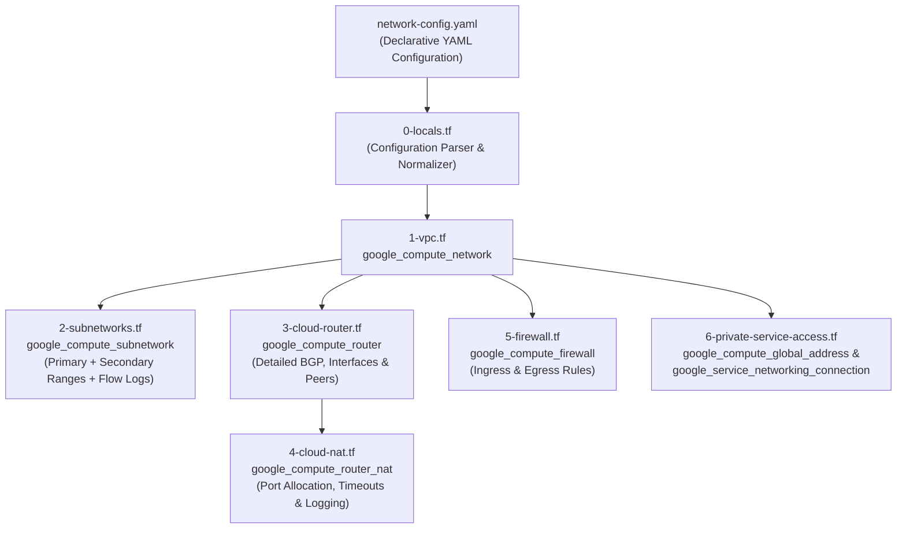

# GCP VPC, Subnetworks, Cloud Router (BGP), Cloud NAT, Firewall & Private Service Access Module

A production-grade, YAML-driven Terraform module for Google Cloud Platform (GCP) modeled after the official Google Cloud Terraform modules:
- [`terraform-google-modules/network/google`](https://registry.terraform.io/modules/terraform-google-modules/network/google/latest) (VPC, Subnets, Secondary Ranges, Flow Logs, Firewall Rules, Private Service Access)
- [`terraform-google-modules/cloud-router/google`](https://registry.terraform.io/modules/terraform-google-modules/cloud-router/google/latest) (Cloud Router with detailed BGP configuration, custom route advertisements, interfaces, and BGP peers)
- [`terraform-google-modules/cloud-nat/google`](https://registry.terraform.io/modules/terraform-google-modules/cloud-nat/google/latest) (Cloud NAT with port allocation, timeouts, custom subnetwork mapping, and logging)

---

## Architecture Overview



---

## Key Features

1. **VPC Network (`1-vpc.tf`)**:
   - Custom mode VPC (`auto_create_subnetworks = false` by default).
   - Configurable `routing_mode` (`GLOBAL` or `REGIONAL`), `mtu`, IPv6 ULA support, default internet gateway route deletion, and firewall policy enforcement order.
2. **Subnetworks (`2-subnetworks.tf`)**:
   - Multi-region subnet creation (`subnet_name`, `subnet_ip`, `subnet_region`, `subnet_private_access`).
   - Secondary IP ranges (`secondary_ranges`) for GKE Pods and Services.
   - VPC Flow Logs (`subnet_flow_logs`) with configurable interval, sampling, metadata, and filter expressions.
3. **Cloud Router & Detailed BGP (`3-cloud-router.tf`)**:
   - Dedicated regional Cloud Routers with full BGP support (`asn`, `advertise_mode`, `advertised_groups`, `advertised_ip_ranges`, `keepalive_interval`, `identifier_range`).
   - Optional Router Interfaces (`google_compute_router_interface`) and BGP Peers (`google_compute_router_peer`) with BFD support.
4. **Cloud NAT (`4-cloud-nat.tf`)**:
   - Auto or manual IP allocation (`AUTO_ONLY` / `MANUAL_ONLY`).
   - Static or dynamic port allocation (`min_ports_per_vm`, `max_ports_per_vm`, `enable_dynamic_port_allocation`).
   - Configurable TCP/UDP/ICMP idle timeouts and NAT logging (`ERRORS_ONLY`, `TRANSLATIONS_ONLY`, `ALL`).
5. **Firewall Rules (`5-firewall.tf`)**:
   - Clean `ingress` and `egress` grouping in YAML.
   - Supports simple `ports` shorthand (defaults to TCP) as well as multi-protocol `allow` and `deny` blocks, `source_ranges`, `destination_ranges`, `source_tags`, `target_tags`, service accounts, and rule logging.
6. **Private Service Access (`6-private-service-access.tf`)**:
   - Reserves internal IP address ranges (`google_compute_global_address`) for `VPC_PEERING`.
   - Establishes private connection (`google_service_networking_connection`) to `servicenetworking.googleapis.com` for Cloud SQL, Memorystore, Filestore, and Vertex AI.
   - Optional custom route import/export (`google_compute_network_peering_routes_config`).

---

## Requirements

| Name | Version |
|------|---------|
| <a name="requirement_terraform"></a> [terraform](#requirement\_terraform) | `>= 1.5.0` |
| <a name="requirement_google"></a> [google](#requirement\_google) | `>= 5.0.0, < 7.0.0` |

---

## Inputs

| Name | Description | Type | Required |
|------|-------------|------|:--------:|
| `config_file_path` | Path to the YAML network configuration file. | `string` | yes |

---

## Outputs

| Name | Description |
|------|-------------|
| `project_id` | The GCP project ID where networking resources are provisioned. |
| `tags` | Common metadata tags/labels defined in the YAML configuration. |
| `vpcs` | Detailed map of created VPC networks (`id`, `name`, `self_link`, `gateway_ipv4`, `routing_mode`, `mtu`). |
| `vpc_ids` | Lookup map of VPC name to VPC ID. |
| `vpc_self_links` | Lookup map of VPC name to VPC self link. |
| `subnets` | Detailed map of created subnetworks including `secondary_ranges_map` for GKE. |
| `subnet_ids` | Lookup map of subnet name to subnet ID. |
| `subnet_self_links` | Lookup map of subnet name to subnet self link. |
| `subnet_cidrs` | Lookup map of subnet name to primary IP CIDR block. |
| `routers` | Detailed map of created Cloud Routers including `bgp` configuration. |
| `router_ids` | Lookup map of Cloud Router name to Router ID. |
| `router_self_links` | Lookup map of Cloud Router name to Router self link. |
| `router_bgp_peers` | Detailed map of created Cloud Router BGP peers. |
| `nat_gateways` | Detailed map of created Cloud NAT gateways. |
| `nat_ids` | Lookup map of Cloud NAT name to Cloud NAT ID. |
| `firewall_rules` | Detailed map of created Firewall Rules. |
| `firewall_rule_ids` | Lookup map of firewall rule name to Firewall ID. |
| `firewall_rule_self_links` | Lookup map of firewall rule name to Firewall self link. |
| `private_service_access_ranges` | Map of allocated internal IP ranges for Private Service Access (`id`, `address`, `prefix_length`, `cidr`). |
| `private_service_access_connections` | Details of the Private Service Access service networking peering connections. |

---

## YAML Configuration Reference (`network-config.yaml`)

```yaml
project_id: yuvaraj-internal-project
region: asia-south1

tags:
  provisioned_by: terraform
  environment: dev
  project: gcp-platform-foundation-terraform

network:
  vpcs:
    # ==========================================================================
    # VPC 1: Platform Foundation VPC
    # ==========================================================================
    - network_name: platform-foundation-vpc
      routing_mode: GLOBAL
      description: "Platform Foundation VPC"
      delete_default_internet_gateway_routes: false

      # Private Service Access (for Cloud SQL, Memorystore, etc.)
      private_service_access:
        enabled: true
        name: platform-foundation-psa-range
        prefix_length: 16
        export_custom_routes: true
        import_custom_routes: true

      # Subnet Configuration
      subnets:
        - subnet_name: private-subnet-mumbai
          subnet_ip: 10.20.1.0/24
          subnet_region: asia-south1
          subnet_private_access: true
          subnet_flow_logs: false
          secondary_ranges:
            - range_name: gke-pods
              ip_cidr_range: 10.200.0.0/16
            - range_name: gke-services
              ip_cidr_range: 10.201.0.0/20

        - subnet_name: private-subnet-singapore
          subnet_ip: 10.30.1.0/24
          subnet_region: asia-southeast1
          subnet_private_access: true

      # Firewall Rules
      firewall_rules:
        ingress:
          - name: allow-iap-ssh
            source_ranges:
              - 35.235.240.0/20
            target_tags:
              - allow-iap-ssh
            ports:
              - "22"

          - name: allow-health-check
            source_ranges:
              - 130.211.0.0/22
              - 35.191.0.0/16
            target_tags:
              - allow-health-check
            ports:
              - "8080"

          - name: allow-load-balancer
            source_ranges:
              - 130.211.0.0/22
              - 35.191.0.0/16
            target_tags:
              - allow-web
            ports:
              - "80"
              - "443"
              - "8080"

        egress:
          - name: allow-internet
            destination_ranges:
              - 0.0.0.0/0
            ports:
              - "80"
              - "443"

      # Cloud Routers (with BGP Configuration)
      router:
        - name: cloud-router-mumbai
          region: asia-south1
          bgp:
            asn: "65001"
            advertise_mode: DEFAULT
            keepalive_interval: 20

        - name: cloud-router-singapore
          region: asia-southeast1
          bgp:
            asn: "65002"
            advertise_mode: CUSTOM
            advertised_groups:
              - ALL_SUBNETS
            advertised_ip_ranges:
              - range: 10.30.1.0/24
                description: "Singapore Primary Subnet"

      # Cloud NATs
      nat:
        - name: cloud-nat-mumbai
          region: asia-south1
          router_name: cloud-router-mumbai
          min_ports_per_vm: 64
          enable_logging: true
          log_filter: ERRORS_ONLY

        - name: cloud-nat-singapore
          region: asia-southeast1
          router_name: cloud-router-singapore
          min_ports_per_vm: 64
          enable_logging: true
          log_filter: ERRORS_ONLY

    # ==========================================================================
    # VPC 2: Management & Security VPC
    # ==========================================================================
    - network_name: management-security-vpc
      routing_mode: REGIONAL
      description: "Management, Bastion & Shared Security Tools VPC"

      private_service_access:
        enabled: true
        name: management-security-psa-range
        prefix_length: 20

      subnets:
        - subnet_name: mgmt-subnet-mumbai
          subnet_ip: 10.50.1.0/24
          subnet_region: asia-south1
          subnet_private_access: true

        - subnet_name: mgmt-subnet-singapore
          subnet_ip: 10.60.1.0/24
          subnet_region: asia-southeast1
          subnet_private_access: true

      firewall_rules:
        ingress:
          - name: mgmt-allow-iap-ssh
            source_ranges:
              - 35.235.240.0/20
            target_tags:
              - mgmt-bastion
            ports:
              - "22"

        egress:
          - name: mgmt-allow-internet
            destination_ranges:
              - 0.0.0.0/0
            ports:
              - "80"
              - "443"

      router:
        - name: mgmt-router-mumbai
          region: asia-south1
          bgp:
            asn: "65011"
        - name: mgmt-router-singapore
          region: asia-southeast1
          bgp:
            asn: "65012"

      nat:
        - name: mgmt-nat-mumbai
          region: asia-south1
          router_name: mgmt-router-mumbai
        - name: mgmt-nat-singapore
          region: asia-southeast1
          router_name: mgmt-router-singapore
```

---

## Module Usage (`main.tf`)

```hcl
module "networking" {
  source           = "git::https://github.com/yuva-cloud-devops/gcp-terraform-custom-modules.git//networking-infrastructure/vpc-subnet-router-nat-firewall?ref=main"
  config_file_path = "${path.module}/network-config.yaml"
}
```
