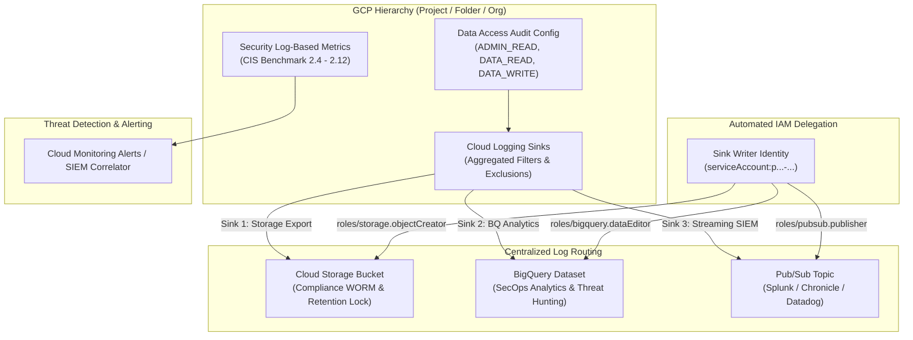

# GCP Audit & Compliance Infrastructure Terraform Module (`audit-compliance-infra`)

Enterprise-grade, **YAML-driven** Terraform module for automated provisioning and orchestration of **Google Cloud Audit Logging, Centralized SIEM Log Sinks, Compliance WORM Storage, and CIS GCP Foundations Benchmark Log-Based Metrics**.

---

## 🏛️ Architecture Overview



---

## 🎯 Key Capabilities

1. **Hierarchy-Wide Data Access Audit Logging**:
   - Supports `project`, `folder`, or `organization` scopes.
   - Enforces `ADMIN_READ`, `DATA_READ`, and `DATA_WRITE` logging for critical services (`allServices`, `storage.googleapis.com`, `bigquery.googleapis.com`, etc.) with member exemptions.
2. **Managed Compliance Storage Destinations**:
   - **Cloud Storage**: Uniform bucket-level access, object versioning, WORM retention policy with compliance lock, and lifecycle rules.
   - **BigQuery Datasets**: Dedicated analytics datasets with configurable table expiration and optional CMEK encryption.
   - **Pub/Sub Topics**: High-throughput message streaming to external SIEMs (Chronicle, Splunk, Datadog, Microsoft Sentinel).
3. **Automated Log Sinks & Writer IAM Delegation**:
   - Supports shorthand destinations (`bucket:name`, `bigquery:dataset`, `pubsub:topic`) and fully-qualified GCP URIs.
   - Automatically grants required writer permissions (`roles/storage.objectCreator`, `roles/bigquery.dataEditor`, `roles/pubsub.publisher`) to the sink's generated `writer_identity`.
4. **Built-in CIS GCP Foundations Benchmark Log Metrics**:
   - Automatically provisions Section 2 security log-based metrics:
     - **CIS 2.4**: IAM policy changes
     - **CIS 2.5**: Audit configuration changes
     - **CIS 2.6**: Custom IAM role changes
     - **CIS 2.7**: VPC firewall rule changes
     - **CIS 2.8**: Network route changes
     - **CIS 2.9**: VPC network and subnet changes
     - **CIS 2.10**: Cloud Storage bucket IAM changes
     - **CIS 2.11**: Cloud SQL instance changes
     - **CIS 2.12**: Cloud KMS cryptographic key destruction

---

## 📋 YAML Configuration Schema

```yaml
project_id: "my-gcp-project-id"
default_location: "asia-south1"

common_labels:
  environment: "production"
  managed_by: "terraform"
  compliance: "cis-benchmark"

# ------------------------------------------------------------------------------
# 1. Data Access Audit Logs Configuration
# ------------------------------------------------------------------------------
audit_logs:
  scope: "project" # 'project', 'folder', or 'organization'
  target_id: "my-gcp-project-id"
  services:
    - service: "allServices"
      log_types:
        - "ADMIN_READ"
        - "DATA_READ"
        - "DATA_WRITE"
      exempted_members: []

# ------------------------------------------------------------------------------
# 2. Managed Audit Destinations (Optional)
# ------------------------------------------------------------------------------
destinations:
  storage_buckets:
    - name: "my-org-cold-audit-logs"
      location: "asia-south1"
      storage_class: "STANDARD"
      versioning: true
      retention_policy:
        retention_period_days: 365
        is_locked: false
      lifecycle_rules:
        - action:
            type: "SetStorageClass"
            storage_class: "COLDLINE"
          condition:
            age: 90

  bigquery_datasets:
    - dataset_id: "security_audit_analytics"
      location: "asia-south1"
      description: "Centralized Audit Analytics for Threat Hunting"
      default_table_expiration_ms: 7776000000 # 90 days

  pubsub_topics:
    - name: "siem-audit-stream"

# ------------------------------------------------------------------------------
# 3. Centralized Log Sinks
# ------------------------------------------------------------------------------
log_sinks:
  - name: "export-to-cold-storage"
    scope: "project"
    destination: "bucket:my-org-cold-audit-logs"
    filter: 'protoPayload.@type="type.googleapis.com/google.cloud.audit.AuditLog"'
    exclusions:
      - name: "exclude-liveness-probes"
        filter: 'protoPayload.methodName="google.monitoring.v3.UptimeCheckService.GetUptimeCheckConfig"'

  - name: "export-to-bigquery"
    scope: "project"
    destination: "bigquery:security_audit_analytics"
    filter: 'protoPayload.@type="type.googleapis.com/google.cloud.audit.AuditLog"'

  - name: "export-to-siem"
    scope: "project"
    destination: "pubsub:siem-audit-stream"
    filter: 'severity >= WARNING'

# ------------------------------------------------------------------------------
# 4. Security Metrics (CIS Benchmark + Custom)
# ------------------------------------------------------------------------------
security_metrics:
  enable_cis_benchmarks: true
  custom_metrics:
    - name: "secret_manager_access_denied"
      description: "Alerts on unauthorized Secret Manager access attempts"
      filter: 'protoPayload.serviceName="secretmanager.googleapis.com" AND protoPayload.status.code=7'
```

---

## 🚀 Terraform Usage

```hcl
module "audit_compliance" {
  source = "../../secops-infrastructure/audit-compliance-infra"

  config_file_path = "${path.module}/audit-compliance.yaml"
}

output "sinks" {
  value = module.audit_compliance.sinks
}

output "writer_identities" {
  value = module.audit_compliance.sink_writer_identities
}
```

---

## 🔒 CIS GCP Benchmark Mappings

| CIS Control | Metric Name | Description |
|:---|:---|:---|
| **CIS 2.4** | `cis_iam_policy_changes` | IAM role & policy changes |
| **CIS 2.5** | `cis_audit_config_changes` | Audit log configuration changes |
| **CIS 2.6** | `cis_custom_role_changes` | Custom IAM role creation/deletion/update |
| **CIS 2.7** | `cis_firewall_rule_changes` | VPC firewall rule modifications |
| **CIS 2.8** | `cis_network_route_changes` | Network route modifications |
| **CIS 2.9** | `cis_vpc_network_changes` | VPC network & subnet modifications |
| **CIS 2.10** | `cis_storage_iam_changes` | GCS bucket IAM permission changes |
| **CIS 2.11** | `cis_cloud_sql_changes` | Cloud SQL configuration updates |
| **CIS 2.12** | `cis_kms_key_destruction` | KMS key scheduled destruction |
