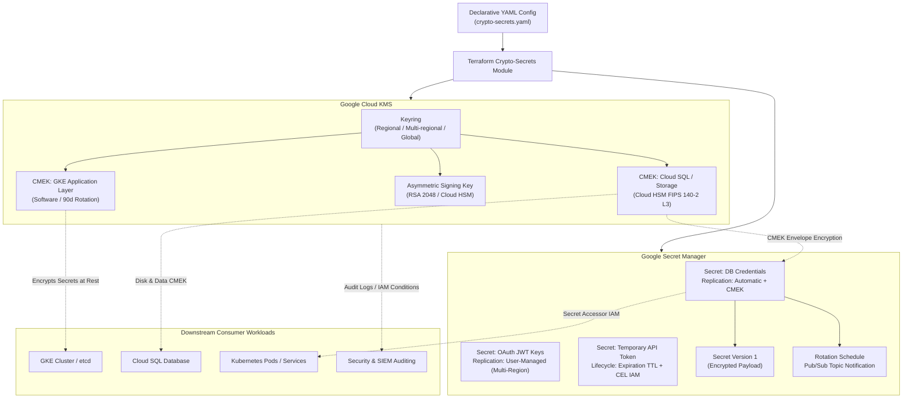

# Google Cloud Crypto & Secrets Infrastructure Custom Module

[](https://www.terraform.io/)
[](https://cloud.google.com/)
[](#declarative-yaml-schema)
[](#architecture-overview)

This custom Terraform module provides a dynamic, enterprise-grade implementation of **Google Cloud Key Management Service (Cloud KMS)** and **Google Secret Manager**, driven entirely by human-readable, declarative YAML configurations.

It establishes the foundational cryptography and secrets management layer required across downstream workloads—including Google Kubernetes Engine (GKE), Cloud SQL, Cloud Storage, BigQuery, Artifact Registry, Compute Engine, and zero-trust microservice applications.

---

## Table of Contents

- [Architecture Overview](#architecture-overview)
- [Enterprise Features](#enterprise-features)
  - [Cloud KMS Architecture](#cloud-kms-architecture)
  - [Secret Manager Architecture](#secret-manager-architecture)
- [Directory Structure](#directory-structure)
- [Declarative YAML Schema](#declarative-yaml-schema)
- [Terraform Module Usage](#terraform-module-usage)
- [Module Inputs](#module-inputs)
- [Module Outputs](#module-outputs)
- [Security & Compliance Highlights](#security--compliance-highlights)

---

## Architecture Overview



---

## Enterprise Features

### Cloud KMS Architecture
- **Keyrings**: Automated provisioning across regional (`asia-south1`), multi-regional (`asia`, `us`, `eu`), or global locations.
- **Customer-Managed Encryption Keys (CMEK)**: Enforces envelope encryption across Google services (GKE application-layer secret encryption, Cloud SQL, BigQuery, Artifact Registry, GCS, Pub/Sub).
- **Hardware Security Modules (Cloud HSM)**: Support for FIPS 140-2 Level 3 validated HSM protection levels (`HSM`) alongside standard software-backed keys (`SOFTWARE`).
- **Key Purpose Versatility**: Supports symmetric encryption/decryption (`ENCRYPT_DECRYPT`), asymmetric digital signing (`ASYMMETRIC_SIGN`), asymmetric decryption (`ASYMMETRIC_DECRYPT`), and raw envelope keys (`RAW_ENCRYPT_DECRYPT`).
- **Automated Rotation Schedules**: Configurable rotation periods (e.g., `7776000s` / 90 days, `2592000s` / 30 days) automatically constrained to symmetric keys.
- **Destruction Delay Protection**: Configurable `destroy_scheduled_duration` (e.g., `86400s` to prevent accidental immediate loss).
- **Authoritative per-member IAM**: Implements non-destructive `google_kms_*_iam_member` bindings supporting Common Expression Language (CEL) conditions.

### Secret Manager Architecture
- **Flexible Replication Strategies**:
  - **Automatic Replication**: Replicated across Google-managed locations with optional customer-managed encryption (CMEK).
  - **User-Managed Replication**: Multi-region replicas explicitly bound to distinct geographical regions (e.g., `asia-south1` and `asia-south2`) with optional per-replica CMEK keys.
- **Dynamic Key Cross-Referencing**: Automatically resolves CMEK key references defined within the same YAML (`keyring_name/key_name` or `key_name`) without requiring hardcoded, error-prone GCP resource IDs.
- **Automated Secret Rotation**: Schedules periodic rotation with Cloud Pub/Sub topic integration for event-driven rotation handlers (Cloud Functions, Cloud Run).
- **Lifecycle Management**: Configurable time-to-live (`ttl`) and absolute expiration timestamps (`expire_time`).
- **Secret Payloads**: Allows provisioning initial secret versions with granular deletion policies (`DELETE`, `DISABLE`, `ABANDON`) or provisioning secret containers for out-of-band pipeline population.
- **Least-Privilege Secret IAM**: Granular member-level access control (`roles/secretmanager.secretAccessor`, `roles/secretmanager.secretVersionManager`) with CEL temporal/attribute conditions.

---

## Directory Structure

```
crypto-secrets-infra/
├── 0-locals.tf            # Dynamic YAML parsing, data transformation pipeline, CMEK resolver
├── 1-kms-keyrings.tf      # Cloud KMS Keyring resource declarations
├── 2-kms-keys.tf          # Symmetric & Asymmetric CryptoKey definitions
├── 3-kms-iam.tf           # Keyring, CryptoKey, and Project KMS IAM member bindings
├── 4-secret-manager.tf    # Secret Manager Secret resource declarations with replication & rotation
├── 5-secret-versions.tf   # Optional initial Secret Version payload management
├── 6-secret-iam.tf        # Secret-level & Project-level Secret Manager IAM member bindings
├── variables.tf           # Module input variables
├── outputs.tf             # Comprehensive outputs for KMS, Secrets, and summary metrics
├── versions.tf            # Terraform and Google provider constraints
└── README.md              # Technical module documentation
```

---

## Declarative YAML Schema

```yaml
# Top-level Global Defaults
project_id: "prj-secops-prod-01"
default_location: "asia-south1"

# Common labels applied to all KMS keys and Secrets
common_labels:
  environment: "production"
  managed_by: "terraform"
  domain: "secops"

# ==============================================================================
# Cloud KMS
# ==============================================================================
kms:
  # Optional Project-Level KMS IAM
  project_iam:
    - role: "roles/cloudkms.admin"
      members:
        - "group:gcp-kms-admins@example.com"

  keyrings:
    - name: "secops-keyring-mumbai"
      location: "asia-south1"
      
      # Keyring-level IAM
      iam:
        - role: "roles/cloudkms.viewer"
          members:
            - "group:gcp-security-auditors@example.com"

      keys:
        - name: "cmek-gke-etcd"
          purpose: "ENCRYPT_DECRYPT"           # Default: ENCRYPT_DECRYPT
          rotation_period: "7776000s"         # 90 Days
          destroy_scheduled_duration: "86400s" # 24 Hours
          labels:
            workload: "gke"
          version_template:
            algorithm: "GOOGLE_SYMMETRIC_ENCRYPTION"
            protection_level: "SOFTWARE"      # SOFTWARE or HSM
          iam:
            - role: "roles/cloudkms.cryptoKeyEncrypterDecrypter"
              members:
                - "serviceAccount:service-1029384756@container-engine-robot.iam.gserviceaccount.com"

        - name: "cmek-cloud-sql"
          purpose: "ENCRYPT_DECRYPT"
          rotation_period: "2592000s"         # 30 Days
          version_template:
            algorithm: "GOOGLE_SYMMETRIC_ENCRYPTION"
            protection_level: "HSM"           # Hardware Security Module
          iam:
            - role: "roles/cloudkms.cryptoKeyEncrypterDecrypter"
              members:
                - "serviceAccount:p1029384756-abcdef@gcp-sa-cloud-sql.iam.gserviceaccount.com"

        - name: "app-code-signing-key"
          purpose: "ASYMMETRIC_SIGN"
          version_template:
            algorithm: "RSA_SIGN_PSS_2048_SHA256"
            protection_level: "HSM"
          iam:
            - role: "roles/cloudkms.signerVerifier"
              members:
                - "serviceAccount:sa-release-pipeline@prj-secops-prod-01.iam.gserviceaccount.com"

# ==============================================================================
# Secret Manager
# ==============================================================================
secret_manager:
  # Optional Project-Level Secret Manager IAM
  project_iam:
    - role: "roles/secretmanager.viewer"
      members:
        - "group:gcp-security-auditors@example.com"

  secrets:
    - secret_id: "db-credentials-master"
      labels:
        application: "order-service"
      annotations:
        security_poc: "secops@example.com"

      # Automatic Replication with CMEK
      replication:
        type: "automatic"
        customer_managed_encryption:
          # Refers to key defined in this YAML as 'keyring_name/key_name'
          kms_key_name: "secops-keyring-mumbai/cmek-cloud-sql"

      # Rotation Policy
      rotation:
        rotation_period: "2592000s"

      # Notification Topics
      topics:
        - name: "projects/prj-secops-prod-01/topics/secret-rotation-alerts"

      # Initial Secret Version
      version:
        enabled: true
        secret_data: "P@ssw0rdSecureProduction2026!"
        deletion_policy: "DELETE" # DELETE, DISABLE, or ABANDON

      # Secret-level IAM
      iam:
        - role: "roles/secretmanager.secretAccessor"
          members:
            - "serviceAccount:sa-order-service@prj-secops-prod-01.iam.gserviceaccount.com"

    - secret_id: "oauth-jwt-private-key"
      replication:
        type: "user_managed"
        replicas:
          - location: "asia-south1"
          - location: "asia-south2"
      iam:
        - role: "roles/secretmanager.secretAccessor"
          members:
            - "serviceAccount:sa-auth-service@prj-secops-prod-01.iam.gserviceaccount.com"
```

---

## Terraform Module Usage

### 1. File-Based YAML Configuration (Recommended)

```hcl
module "crypto_secrets" {
  source           = "./secops-infrastructure/crypto-secrets-infra"
  config_file_path = "${path.module}/crypto-secrets.yaml"
}
```

### 2. Inline YAML Content Configuration

```hcl
module "crypto_secrets" {
  source       = "./secops-infrastructure/crypto-secrets-infra"
  yaml_content = <<-EOT
    project_id: "prj-secops-prod-01"
    kms:
      keyrings:
        - name: "app-keyring"
          location: "asia-south1"
          keys:
            - name: "app-key"
              purpose: "ENCRYPT_DECRYPT"
  EOT
}
```

---

## Module Inputs

| Name | Type | Default | Description |
| :--- | :--- | :--- | :--- |
| `config_file_path` | `string` | `null` | Path to the YAML configuration file defining KMS keyrings, keys, secrets, and IAM. |
| `yaml_content` | `string` | `null` | Raw YAML string content. If provided, overrides `config_file_path`. |

---

## Module Outputs

| Name | Type | Description |
| :--- | :--- | :--- |
| `keyrings` | `map(object)` | Detailed map of provisioned KMS keyrings (`id`, `name`, `location`, `project`). |
| `keyring_ids` | `map(string)` | Map of KMS keyring names to full resource IDs. |
| `keys` | `map(object)` | Detailed map of provisioned KMS CryptoKeys indexed by `'<keyring>/<key>'`. |
| `key_ids` | `map(string)` | Map of composite key names to full KMS CryptoKey resource IDs. |
| `key_ids_by_name` | `map(string)` | Convenience lookup of short key names directly to full CryptoKey IDs. |
| `secrets` | `map(object)` | Detailed map of provisioned Secret Manager secrets. |
| `secret_ids` | `map(string)` | Map of secret IDs to full resource IDs (`projects/{{project}}/secrets/{{id}}`). |
| `secret_names` | `map(string)` | Map of secret IDs to Secret Manager resource names. |
| `secret_versions` | `map(object)` | Metadata of provisioned initial secret versions (payloads redacted). |
| `summary` | `object` | Statistical summary of created keyrings, keys, secrets, and versions. |

---

## Security & Compliance Highlights

- **CIS GCP Foundations Benchmark**: Enforces automated cryptographic key rotation schedules (<= 90 days) on all symmetric CMEK keys.
- **FIPS 140-2 Level 3 Validation**: Full support for Google Cloud HSM for compliance frameworks (PCI-DSS 3.4/3.5, HIPAA, FedRAMP High).
- **Non-Authoritative Member IAM**: All role assignments utilize `google_*_iam_member` rather than authoritative `_binding` or `_policy` resources, preventing accidental privilege revocation of Google system robot agents.
- **ABAC with CEL Conditions**: Granular IAM bindings support Common Expression Language conditions (e.g., temporal expiration, VPC origin, request attributes).
- **Data-at-Rest Protection**: Out-of-the-box integration for CMEK wrapping on Secret Manager secrets and downstream GKE/Cloud SQL infrastructure.
