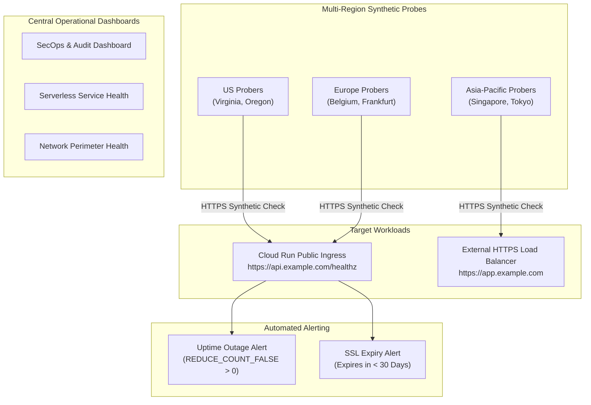

# GCP Dashboards & Synthetic Uptime Infrastructure Terraform Module (`dashboards-uptime-infra`)

Enterprise-grade, **YAML-driven** Terraform module for automated provisioning and orchestration of **Multi-Region Synthetic Uptime Checks, Automated SSL/TLS Certificate Expiration Alerts, and Pre-Packaged Cloud Monitoring Dashboards**.

---

## 🏛️ Architecture Overview



---

## 🎯 Key Capabilities

1. **Multi-Region Synthetic Probes**:
   - Deploys regional probers across `USA`, `EUROPE`, `ASIA_PACIFIC`, and `SOUTH_AMERICA`.
   - Supports `HTTPS`, `HTTP`, and `TCP` checks with configurable timeout, period, and response status class validation (`STATUS_CLASS_2XX`).
   - Supports custom HTTP headers and content matchers.
2. **Automated Incident Alerting**:
   - **Outage Detection**: Alert policy triggers immediately when probers report consecutive failure across regions.
   - **SSL/TLS Expiry Protection**: Alert policy triggers proactively when target certificate lifetime falls below threshold (e.g., 30 days).
3. **Pre-Packaged Production Dashboards**:
   - **SecOps & Audit Compliance**: Real-time graphs for CIS 2.4 (IAM changes), CIS 2.7 (Firewall changes), CIS 2.10 (Bucket IAM), and CIS 2.12 (KMS destruction).
   - **Serverless Operations**: Request counts by response code (2xx/4xx/5xx), p95 latency, container instance scaling, and Cloud Tasks backlog depths.
   - **Network Perimeter Health**: Cloud NAT translation errors, HA VPN tunnel sent/received throughput, and BGP routing status.
   - **Custom Dashboards**: Easily import JSON dashboard templates via YAML.

---

## 📋 YAML Configuration Schema

```yaml
project_id: "secops-monitoring-project"

# 1. Synthetic Uptime Checks
uptime_checks:
  - name: "public-api-health-check"
    display_name: "Public API Gateway (/healthz)"
    host: "api.example.com"
    protocol: "HTTPS"
    path: "/healthz"
    port: 443
    period: "60s"
    timeout: "10s"
    selected_regions:
      - "USA"
      - "EUROPE"
      - "ASIA_PACIFIC"
    alert_on_failure: true
    alert_on_ssl_expiry: true
    ssl_expiry_days: 30
    notification_channels:
      - "projects/secops-monitoring-project/notificationChannels/123456789"
    content_matchers:
      - content: '"status":"UP"'
        matcher: "CONTAINS_STRING"

# 2. Cloud Monitoring Dashboards
dashboards:
  enable_secops_dashboard: true
  enable_serverless_dashboard: true
  enable_network_dashboard: true
```

---

## 🚀 Usage Example

```hcl
module "dashboards_uptime" {
  source           = "git::https://github.com/yuva-cloud-devops/gcp-terraform-custom-modules.git//secops-infrastructure/dashboards-uptime-infra?ref=main"
  config_file_path = "${path.module}/dashboards-uptime-config.yaml"
}
```
