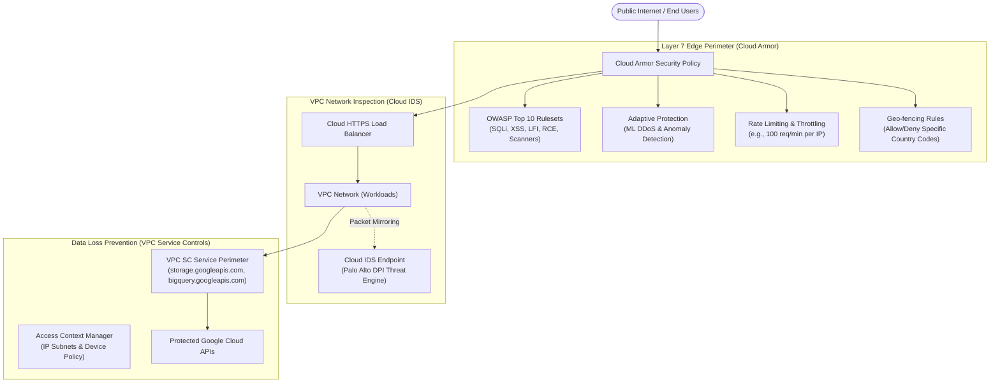

# Google Cloud Edge Security Infrastructure Custom Module

[](https://www.terraform.io/)
[](https://cloud.google.com/)
[](#architecture-overview)

The **Edge Security Infrastructure** module provisions comprehensive perimeter protection, edge defense, deep packet inspection, and data exfiltration guardrails for Google Cloud workloads driven by a single, declarative YAML configuration file.

---

## Architecture Overview



---

## Features

1. **Cloud Armor WAF & Layer 7 DDoS**:
   - Preconfigured OWASP Top 10 mitigation rulesets (`sqli-v33-stable`, `xss-v33-stable`, `lfi-v33-stable`, `rce-v33-stable`, `scannerdetection-v33-stable`, `protocolattack-v33-stable`, `php-v33-stable`, `sessionfixation-v33-stable`).
   - Rate limiting, throttling, and automated bans (e.g., ban IP for 5 minutes when exceeding threshold).
   - Geo-fencing via CEL expressions (`origin.region_code == '...'`).
   - Machine Learning Layer 7 Adaptive Protection.
2. **Cloud IDS (Intrusion Detection System)**:
   - Deep Packet Inspection (DPI) powered by Palo Alto Networks threat signatures.
   - Real-time detection of network malware, command-and-control (C2), and vulnerability exploits.
   - Configurable alert severity levels (`INFORMATIONAL`, `LOW`, `MEDIUM`, `HIGH`, `CRITICAL`).
3. **VPC Service Controls (VPC SC)**:
   - Context-aware Access Levels (trusted CIDR subnets, corporate identities).
   - Enforced or dry-run Service Perimeters enclosing sensitive APIs (`storage.googleapis.com`, `bigquery.googleapis.com`, etc.).
   - Explicit ingress and egress boundary rules for safe data exchange across perimeters.

---

## Preconfigured OWASP Rulesets Reference

| Ruleset Identifier | Threat Category | Description |
|---|---|---|
| `sqli-v33-stable` | SQL Injection | Detects and blocks SQL syntax manipulation attacks |
| `xss-v33-stable` | Cross-Site Scripting | Blocks reflected and stored script execution attacks |
| `lfi-v33-stable` | Local File Inclusion | Prevents path traversal and sensitive system file reads |
| `rfi-v33-stable` | Remote File Inclusion | Blocks inclusion of external URLs into application code |
| `rce-v33-stable` | Remote Code Execution | Prevents operating system command injection |
| `scannerdetection-v33-stable` | Vulnerability Scanners | Identifies automated scanner probes (Nmap, Nikto, Acunetix) |
| `protocolattack-v33-stable` | Protocol Violations | Detects HTTP request smuggling and header smuggling |
| `php-v33-stable` | PHP Code Injection | Mitigates PHP-specific vulnerability exploits |
| `sessionfixation-v33-stable` | Session Fixation | Protects session tokens against fixation tampering |

---

## Declarative YAML Schema (`edge-security.yaml`)

```yaml
edge_security:
  project_id: "yuvaraj-internal-project"

  # =========================================================================
  # 1. CLOUD ARMOR SECURITY POLICIES & WAF RULES
  # =========================================================================
  cloud_armor_policies:
    secops-web-edge-policy:
      description: "Enterprise Edge WAF with OWASP Top 10, Geo-fencing, and Rate Limiting"
      default_rule_action: "deny(403)"
      adaptive_protection: true
      advanced_options:
        json_parsing: "STANDARD"
        log_level: "VERBOSE"
      rules:
        # Allow corporate office egress IPs
        allow-corporate-ips:
          priority: 1000
          action: "allow"
          description: "Allow trusted corporate egress netblocks"
          ip_ranges:
            - "103.21.244.0/24"

        # Block High-Risk Countries (Geo-fencing)
        block-high-risk-geo:
          priority: 2000
          action: "deny(403)"
          description: "Block traffic originating from embargoed or high-risk jurisdictions"
          expression: "origin.region_code == 'KP' || origin.region_code == 'IR'"

        # OWASP SQL Injection Protection
        owasp-sqli-defense:
          priority: 3000
          action: "deny(403)"
          description: "Mitigate SQL Injection vulnerabilities"
          owasp_ruleset: "sqli-v33-stable"

        # OWASP Cross-Site Scripting (XSS) Protection
        owasp-xss-defense:
          priority: 3100
          action: "deny(403)"
          description: "Mitigate Cross-Site Scripting vulnerabilities"
          owasp_ruleset: "xss-v33-stable"

        # Layer 7 Rate Limiting (Throttle scrapers / brute-force)
        rate-limit-login-endpoints:
          priority: 4000
          action: "throttle"
          description: "Rate limit requests exceeding 120 req/minute per client IP"
          expression: "request.path.startsWith('/login') || request.path.startsWith('/api/v1')"
          rate_limit_options:
            conform_action: "allow"
            exceed_action: "deny(429)"
            enforce_on_key: "IP"
            rate_limit_threshold:
              count: 120
              interval_sec: 60

  # =========================================================================
  # 2. CLOUD IDS (INTRUSION DETECTION SYSTEM) ENDPOINT
  # =========================================================================
  cloud_ids_endpoints:
    secops-ids-asia-south1:
      location: "asia-south1"
      network: "default"
      severity: "HIGH"
      description: "Cloud IDS deep packet inspection endpoint for primary VPC"

  # =========================================================================
  # 3. VPC SERVICE CONTROLS (OPTIONAL - REQUIRES ACCESS POLICY ID)
  # =========================================================================
  # vpc_service_controls:
  #   access_policy_id: "123456789012"
  #   access_levels:
  #     trusted-corp-network:
  #       title: "Corporate Network Boundary"
  #       ip_subnetworks:
  #         - "103.21.244.0/24"
  #   service_perimeters:
  #     secops-data-perimeter:
  #       title: "SecOps Sensitive Data Perimeter"
  #       restricted_services:
  #         - "storage.googleapis.com"
  #         - "bigquery.googleapis.com"
  #       resources:
  #         - "projects/986244541727"
  #       access_levels:
  #         - "trusted-corp-network"
```

---

## Terraform Usage Example

```hcl
module "edge_security" {
  source           = "git::https://github.com/yuva-cloud-devops/gcp-terraform-custom-modules.git//secops-infrastructure/edge-security-infra?ref=main"
  config_file_path = "${path.module}/edge-security.yaml"
}

output "cloud_armor_policies" {
  value = module.edge_security.cloud_armor_policies
}
```
