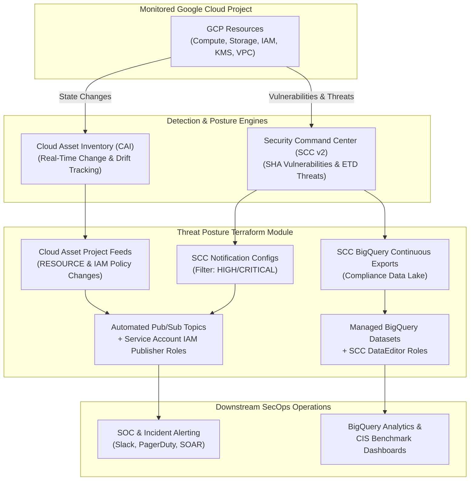

# Threat Posture Infrastructure Module (`threat-posture-infra`)

Enterprise-grade, YAML-driven Terraform module for **Google Cloud Security Command Center (SCC)** vulnerability notification streaming, BigQuery continuous finding exports, and **Cloud Asset Inventory (CAI)** real-time configuration drift feeds.

---

## Architecture Overview



---

## Features

- **SCC v2 Notification Configs**: Automates real-time streaming of active high/critical vulnerabilities, anomalous privilege escalations, and CIS misconfigurations to dedicated Pub/Sub topics.
- **Continuous BigQuery Export**: Automatically provisions analytics datasets and continuous finding exports for long-term SOC audit compliance and posture reporting.
- **Automated Service Account Delegation**: Grants Google-managed SCC (`service-<PROJECT_NUMBER>@gcp-sa-scc-notification.iam.gserviceaccount.com`) and Cloud Asset (`service-<PROJECT_NUMBER>@gcp-sa-cloudasset.iam.gserviceaccount.com`) publishing and write permissions automatically.
- **Real-Time Asset Drift Feeds**: Listens for any creation, modification, or deletion of sensitive infrastructure (Firewalls, Service Accounts, GCS Buckets, KMS Keys) and emits instant event notifications.
- **Pure YAML Configuration**: Supports clean map-based and list-based syntax with dynamic `for_each` resource generation.

---

## YAML Specification

```yaml
threat_posture:
  project_id: "yuvaraj-internal-project"
  location: "global"

  # =========================================================================
  # 1. SECURITY COMMAND CENTER (SCC) NOTIFICATION CONFIGS
  # =========================================================================
  scc_notifications:
    secops-critical-alerts:
      description: "Real-time alerts for High and Critical active vulnerabilities"
      pubsub_topic: "scc-critical-findings-topic"
      filter: 'state="ACTIVE" AND (severity="HIGH" OR severity="CRITICAL")'

    secops-iam-anomalies:
      description: "Alerts for anomalous IAM persistence and privilege grants"
      pubsub_topic: "scc-iam-findings-topic"
      filter: 'category="IAM_ANOMALOUS_GRANT" OR category="PERSISTENCE_CRITICAL"'

  # =========================================================================
  # 2. SECURITY COMMAND CENTER (SCC) BIGQUERY CONTINUOUS EXPORTS
  # =========================================================================
  scc_bigquery_exports:
    secops-findings-archive:
      description: "Continuous export of all active findings to BigQuery"
      dataset_id: "scc_findings_lake"
      dataset_location: "US"
      create_dataset: true
      filter: 'state="ACTIVE"'

  # =========================================================================
  # 3. CLOUD ASSET INVENTORY (CAI) REAL-TIME DRIFT FEEDS
  # =========================================================================
  asset_feeds:
    track-perimeter-resources:
      description: "Real-time drift feed for firewalls, IAM, KMS, and storage buckets"
      pubsub_topic: "asset-drift-feed-topic"
      content_type: "RESOURCE" # RESOURCE, IAM_POLICY, ACCESS_POLICY, OS_INVENTORY
      asset_types:
        - "compute.googleapis.com/Firewall"
        - "storage.googleapis.com/Bucket"
        - "iam.googleapis.com/ServiceAccount"
        - "cloudkms.googleapis.com/CryptoKey"
```

---

## Terraform Usage Example

```hcl
module "threat_posture" {
  source           = "git::https://github.com/yuva-cloud-devops/gcp-terraform-custom-modules.git//secops-infrastructure/threat-posture-infra?ref=main"
  config_file_path = "${path.module}/threat-posture.yaml"
}

output "scc_notifications" {
  value = module.threat_posture.scc_notification_configs
}

output "asset_feeds" {
  value = module.threat_posture.cloud_asset_feeds
}
```
