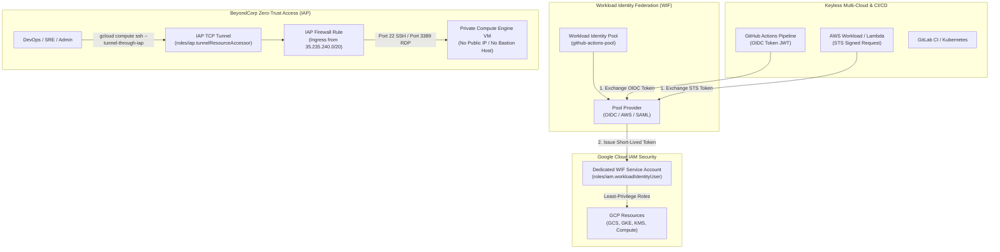

# GCP Zero-Trust Security Infrastructure Terraform Module (`zero-trust-security-infra`)

Enterprise-grade, **YAML-driven** Terraform module for automated provisioning of **Google Cloud Zero-Trust Security Architecture**, specifically **Workload Identity Federation (WIF)** and **Identity-Aware Proxy (IAP)**.

---

## 🏛️ Architecture Overview



---

## 🎯 Key Capabilities

1. **Workload Identity Federation (WIF) - Keyless CI/CD**:
   - Eliminates risky, long-lived service account JSON keys.
   - Provisions Workload Identity Pools and OIDC Providers for **GitHub Actions**, **GitLab CI**, **AWS**, and custom identity providers.
   - Enforces CEL attribute conditions (e.g. restrict to specific GitHub organizations or repositories).
2. **Automated Service Account Impersonation**:
   - Provisions dedicated service accounts with least-privilege project roles.
   - Automatically binds `roles/iam.workloadIdentityUser` to federated claims (`principalSet://.../attribute.repository/...`).
3. **Identity-Aware Proxy (IAP) for TCP Forwarding (SSH & RDP)**:
   - Eliminates external bastion hosts and public IP exposure on private VMs.
   - Provisions the mandatory Google IAP ingress firewall rule (`35.235.240.0/20` on ports 22 and 3389).
   - Manages `roles/iap.tunnelResourceAccessor` with optional CEL conditions (time of day, device posture).
4. **IAP for Web Applications & HTTPS Load Balancers**:
   - Provisions internal OAuth brands and OAuth client IDs.
   - Configures `roles/iap.httpsResourceAccessor` on backend services with CEL conditions.

---

## 📋 YAML Configuration Schema

```yaml
project_id: "my-gcp-project-id"

common_labels:
  environment: "production"
  managed_by: "terraform"
  security_tier: "zero-trust"

# ------------------------------------------------------------------------------
# 1. Workload Identity Federation (WIF)
# ------------------------------------------------------------------------------
workload_identity_federation:
  pools:
    - pool_id: "github-actions-pool"
      display_name: "GitHub Actions CI/CD Pool"
      description: "Keyless authentication for GitHub Actions pipelines"
      disabled: false
      providers:
        - provider_id: "github-provider"
          display_name: "GitHub Actions OIDC Provider"
          description: "OIDC provider for GitHub repo workflows"
          type: "oidc"
          issuer_uri: "https://token.actions.githubusercontent.com"
          attribute_mapping:
            "google.subject": "assertion.sub"
            "attribute.actor": "assertion.actor"
            "attribute.repository": "assertion.repository"
            "attribute.repository_owner": "assertion.repository_owner"
          attribute_condition: "assertion.repository_owner == 'yuva-cloud-devops'"

  service_accounts:
    - account_id: "sa-github-deployer"
      display_name: "GitHub Actions Deployer"
      description: "Service Account impersonated by GitHub Actions via WIF"
      roles:
        - "roles/compute.viewer"
        - "roles/storage.admin"
      bindings:
        - pool: "github-actions-pool"
          attribute: "attribute.repository/yuva-cloud-devops/my-repo"

# ------------------------------------------------------------------------------
# 2. Identity-Aware Proxy (IAP)
# ------------------------------------------------------------------------------
identity_aware_proxy:
  tcp_tunneling:
    enable_firewall: true
    firewall_name: "allow-iap-ingress-ssh-rdp"
    network: "default"
    ports: ["22", "3389"]
    accessors:
      - members:
          - "user:devops-engineer@example.com"
          - "group:secops-team@example.com"
        condition:
          title: "temporary_access_2026"
          expression: "request.time < timestamp('2027-01-01T00:00:00Z')"

  web_applications:
    backend_services:
      - name: "internal-portal-backend"
        accessors:
          - role: "roles/iap.httpsResourceAccessor"
            members:
              - "group:all-employees@example.com"
```

---

## 🚀 Terraform Usage

```hcl
module "zero_trust" {
  source = "../../secops-infrastructure/zero-trust-security-infra"

  config_file_path = "${path.module}/zero-trust.yaml"
}

output "wif_pools" {
  value = module.zero_trust.workload_identity_pools
}

output "service_accounts" {
  value = module.zero_trust.service_accounts
}
```

---

## 🔗 How to Use with GitHub Actions

In your `.github/workflows/deploy.yml`:

```yaml
jobs:
  deploy:
    runs-on: ubuntu-latest
    permissions:
      contents: 'read'
      id-token: 'write'

    steps:
      - uses: 'actions/checkout@v4'

      - id: 'auth'
        uses: 'google-github-actions/auth@v2'
        with:
          workload_identity_provider: 'projects/1234567890/locations/global/workloadIdentityPools/github-actions-pool/providers/github-provider'
          service_account: 'sa-github-deployer@my-gcp-project-id.iam.gserviceaccount.com'

      - name: 'Verify GCP Access'
        run: 'gcloud compute instances list'
```

---

## 🔒 How to Connect via IAP SSH (No Public IP)

```bash
gcloud compute ssh my-private-vm \
  --zone=asia-south1-a \
  --tunnel-through-iap \
  --project=my-gcp-project-id
```
